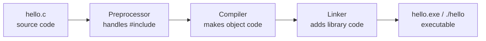
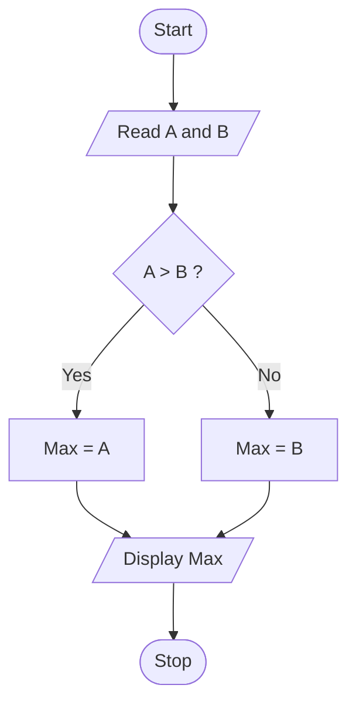

# Session 01: Basics of C, Algorithms and Flowcharts

> Module: Programming in C · Diploma in Cybersecurity and Digital Forensics · Term 1 · ⏱ ~2 hours

C is the language underneath most of the systems a security professional protects: operating systems, network devices, firmware and many hacking tools are written in C. In this first session you will learn what a program really is, where C came from, and how to plan a solution with an algorithm and a flowchart before writing code.

## 🎯 Learning Objectives

- Tell the difference between a command, a program and software
- Describe the history of C and why it is still used today
- Identify the parts of a C program: `#include`, `main()`, statements and blocks
- Write an algorithm for a simple problem in numbered steps
- Draw a flowchart using the standard symbols
- Compile and run your first C program

## 📖 Concepts Explained

### 1. Command, program and software

| Term | Meaning | Example |
|---|---|---|
| Command | One instruction you give the computer | `dir` in Windows CMD, `ls` in Linux |
| Program | A set of instructions saved in a file that solves one task | A calculator program |
| Software | One or more programs plus data, settings and documentation | Microsoft Office, Wireshark |

> **Analogy:** a command is one sentence, a program is a recipe, and software is a full cookbook with pictures and an index.

### 2. A short history of C

- **1960s:** BCPL and then B were used to write early system software.
- **1972:** Dennis Ritchie at Bell Labs created **C** to rewrite the UNIX operating system.
- **1978:** the book *The C Programming Language* (Kernighan & Ritchie) made C popular.
- **1989 onwards:** C was standardised: C89/C90, C99, C11, C17 and C23.

### 3. Why C is still used

- **Fast:** C code turns into machine code with very little overhead.
- **Close to hardware:** you can work directly with memory addresses (pointers).
- **Portable:** the same source can be compiled on Windows, Linux and embedded chips.
- **Security relevance:** the Linux kernel, Windows kernel parts, OpenSSL, Nmap and many routers use C. Understanding C helps you understand bugs such as buffer overflows.

### 4. From source code to running program



You write **source code** in a `.c` file. A **compiler** (for example GCC) translates it into an **executable** that the CPU can run.

### 5. Structure of a C program

```c
#include <stdio.h>      // 1. preprocessor directive: bring in input/output tools

int main(void)          // 2. main function: the program starts here
{                       // 3. opening brace starts a block
    printf("Hi\n");     // 4. a statement, ends with a semicolon
    return 0;           // 5. 0 tells the operating system "finished OK"
}                       // 6. closing brace ends the block
```

| Part | Purpose |
|---|---|
| `#include <stdio.h>` | Includes the standard input/output header so we can use `printf` |
| `int main(void)` | Entry point. Every C program has exactly one `main` |
| `{ }` | A block groups statements together |
| `;` | Ends every statement |
| `// comment` or `/* comment */` | Notes for humans, ignored by the compiler |

### 6. Algorithms

An **algorithm** is a finite, ordered list of clear steps that solves a problem. A good algorithm has input, output, clear steps, and it always finishes.

**Example: find the larger of two numbers**

1. Start
2. Read number A and number B
3. If A is greater than B, the answer is A; otherwise the answer is B
4. Display the answer
5. Stop

### 7. Flowcharts and their symbols

| Symbol | Shape | Meaning |
|---|---|---|
| Terminal | Oval / rounded box | Start or Stop |
| Input/Output | Parallelogram | Read or display data |
| Process | Rectangle | A calculation or assignment |
| Decision | Diamond | A Yes/No question |
| Flow line | Arrow | Direction of steps |
| Connector | Small circle | Joins parts of a large chart |



## 💻 Code Examples

### Example 1: Hello, Cyber World (`hello.c`)

```c
#include <stdio.h>

int main(void)
{
    // print a welcome line on the screen
    printf("Hello, Cyber World!\n");

    // print a second line; \n means "new line"
    printf("My first C program.\n");

    return 0;
}
```

**How it works:** `printf` prints the text inside quotes. `\n` moves the cursor to the next line. `return 0;` ends `main` and reports success.

**Compile and run:**

```bash
gcc hello.c -o hello     # compile: create the program "hello"
./hello                  # run it (on Windows: hello.exe)
```

### Example 2: Larger of two numbers (`larger.c`)

This is the flowchart above turned into code. Do not worry about every detail yet; `scanf` and `if` are explained in the next sessions.

```c
#include <stdio.h>

int main(void)
{
    int a, b;                       // two whole-number boxes

    printf("Enter two numbers: ");
    scanf("%d %d", &a, &b);         // read both numbers

    if (a > b)                      // decision diamond
        printf("Larger is %d\n", a);
    else
        printf("Larger is %d\n", b);

    return 0;
}
```

**How it works:** each step of the algorithm becomes one or two lines of C: read input, make a decision, display output.

## 🧪 Lab Practice

1. Install a C compiler: **MinGW-w64/GCC** or **Code::Blocks** on Windows, or run `sudo apt install build-essential` on Ubuntu/Kali.
2. Type `hello.c`, compile it and run it. Change the message to print your name and batch code.
3. Remove the semicolon after a `printf`, compile again and read the error message. Put it back.
4. Write an algorithm and draw a flowchart for "calculate the area of a rectangle" (input length and width).
5. Compile and run `larger.c`. Test with `5 9`, `9 5` and `7 7`. What happens when both are equal?

## 📝 Assignment

Write an algorithm and draw a flowchart (on paper or with [draw.io](https://www.drawio.com/)) for a simple **login check**: read a PIN, compare it with a stored PIN `4321`, and display "Access granted" or "Access denied". Then write a C program that prints three lines describing what your program will do.

## ❓ Quick Quiz

1. Who created C and in which year?
2. Which flowchart symbol is used for a decision?
3. What does `#include <stdio.h>` give us?
4. Where does every C program begin to run?
5. What is the difference between a program and software?

<details>
<summary>Show answers</summary>

1. Dennis Ritchie, 1972 (Bell Labs)
2. The diamond
3. The standard input/output functions such as `printf` and `scanf`
4. In the `main()` function
5. A program is one set of instructions for a task; software is a collection of programs plus data and documentation.

</details>

## 💼 Interview Questions

**1. Why is C called a middle-level language?**

> It has high-level features (functions, loops, structured code) but also low-level access to memory through pointers, so it sits between assembly and languages like Python.

**2. What does `return 0;` in `main` mean?**

> It sends exit status 0 to the operating system, which by convention means the program finished successfully.

**3. Why should a security analyst learn C?**

> Most operating systems, network services and exploits are written in C. Reading C helps you understand memory bugs, review code and use or build security tools.

## ✅ Summary

- A command is one instruction, a program is a set of instructions, software is a complete package.
- C (1972) is fast, portable and close to the hardware, which is why systems and security tools use it.
- Every C program has `#include` lines, one `main()` function, blocks `{ }` and statements ending in `;`.
- Plan first: write an algorithm, draw a flowchart, then code.

---

[🏠 Module Home](../README.md) · [Next ➡](../Session-02-Variables-Data-Types-and-Input-Output/README.md)

Prepared by Zeeshan Abbas · Aptech Learning North Nazimabad
