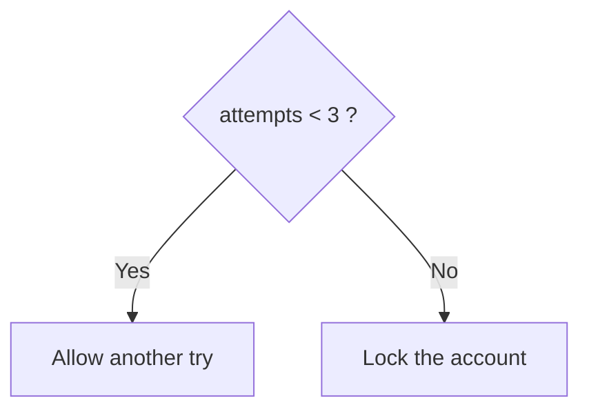

# Session 04: Conditions: if, else and switch

> Module: Programming in C · Diploma in Cybersecurity and Digital Forensics · Term 1 · ⏱ ~2 hours

Programs become useful when they can make decisions: allow or block a login, accept or reject a packet, choose a menu option. In C, decisions are made with `if`, `if-else`, multi-way `else if`, nested `if` and `switch`. This session explains each one with flowcharts and small security-flavoured examples.

## 🎯 Learning Objectives

- Write a simple `if` statement
- Use `if-else` to choose between two paths
- Build a multi-way decision with `else if` (multi if)
- Place one `if` inside another (nested if)
- Use `switch` with `case`, `break` and `default`
- Choose the right decision structure for a problem

## 📖 Concepts Explained

### 1. The `if` statement

```c
if (condition) {
    // runs only when condition is true (non-zero)
}
```

Any non-zero value is true; `0` is false. Always use braces `{ }`, even for one line; it prevents bugs when you add lines later.

### 2. `if - else`



```c
if (attempts < 3) {
    printf("Try again\n");
} else {
    printf("Account locked\n");
}
```

### 3. Multi if (`else if` ladder)

Use it when there are more than two outcomes. C checks each condition from top to bottom and runs the **first** one that is true.

| Score | Risk level |
|---|---|
| 9-10 | Critical |
| 7-8 | High |
| 4-6 | Medium |
| 0-3 | Low |

### 4. Nested `if`

An `if` inside another `if`. Use it when the second question only makes sense if the first answer was yes, e.g. "Is the username right?" and only then "Is the PIN right?".

> **Dangling else:** an `else` belongs to the nearest unmatched `if`. Braces make your intention clear.

### 5. The `switch` statement

`switch` compares one integer or character value against fixed `case` labels.

```c
switch (choice) {
    case 1:  printf("Scan\n");   break;
    case 2:  printf("Report\n"); break;
    default: printf("Invalid\n");
}
```

| Part | Role |
|---|---|
| `switch (expr)` | value to test (int or char) |
| `case value:` | a constant to match |
| `break;` | leave the switch; without it, execution "falls through" to the next case |
| `default:` | runs when nothing matched (like a final `else`) |

### 6. `if` or `switch`?

| Use `if` when... | Use `switch` when... |
|---|---|
| testing ranges (`score >= 7`) | testing one value against fixed options |
| conditions use `&&`, `\|\|` or floats | building a menu (1, 2, 3 or 'a', 'b') |

The **ternary operator** is a short `if-else` for values: `max = (a > b) ? a : b;`

## 💻 Code Examples

### Example 1: if-else login attempts (`if_else.c`)

```c
#include <stdio.h>

int main(void)
{
    int attempts;

    printf("Failed login attempts so far: ");
    scanf("%d", &attempts);

    if (attempts < 3) {
        printf("You may try again.\n");
    } else {
        printf("Account locked. Contact the admin.\n");
    }
    return 0;
}
```

**How it works:** one condition, two paths. Only one of the two blocks runs.

### Example 2: Risk level ladder (`multi_if.c`)

```c
#include <stdio.h>

int main(void)
{
    int score;
    printf("Vulnerability score (0-10): ");
    scanf("%d", &score);

    if (score < 0 || score > 10) {
        printf("Invalid score\n");
    } else if (score >= 9) {
        printf("Critical\n");
    } else if (score >= 7) {
        printf("High\n");
    } else if (score >= 4) {
        printf("Medium\n");
    } else {
        printf("Low\n");
    }
    return 0;
}
```

**How it works:** invalid input is rejected first; then conditions are checked from highest to lowest so the first true branch wins.

### Example 3: Two-step login (`nested_if.c`)

```c
#include <stdio.h>

int main(void)
{
    int userId, pin;
    const int SAVED_ID = 101, SAVED_PIN = 4321;

    printf("User ID: ");
    scanf("%d", &userId);

    if (userId == SAVED_ID) {
        printf("PIN: ");
        scanf("%d", &pin);
        if (pin == SAVED_PIN) {
            printf("Welcome!\n");
        } else {
            printf("Wrong PIN\n");
        }
    } else {
        printf("Unknown user\n");
    }
    return 0;
}
```

**How it works:** the PIN is asked only if the user ID matched. (Real systems never store PINs in code; this is only for learning.)

### Example 4: Tool menu with switch (`switch_menu.c`)

```c
#include <stdio.h>

int main(void)
{
    int choice;
    printf("1. Ping  2. Port check  3. Exit\nChoice: ");
    scanf("%d", &choice);

    switch (choice) {
        case 1:  printf("Running ping...\n");       break;
        case 2:  printf("Checking ports...\n");     break;
        case 3:  printf("Goodbye\n");               break;
        default: printf("Invalid choice\n");
    }
    return 0;
}
```

**How it works:** `choice` is matched against each `case`; `break` stops after the matching message.

## 🧪 Lab Practice

1. Run `if_else.c` with 0, 2, 3 and 10.
2. Run `multi_if.c` with -1, 4, 7, 9 and 11. Then reorder the `else if` lines (Low first) and see why order matters.
3. Remove every `break` from `switch_menu.c`, choose 1, and explain the output (fall-through).
4. Write `grade.c`: read a percentage and print A (80+), B (70-79), C (60-69), D (50-59) or F.
5. Rewrite the two-number "larger" program using the ternary operator.

## 📝 Assignment

Write `port_info.c`: read a port number and use `switch` to print the common service for 21, 22, 23, 25, 53, 80 and 443 (FTP, SSH, Telnet, SMTP, DNS, HTTP, HTTPS). Use `default` for "Unknown/other". Before the switch, use `if` to reject numbers outside 0-65535.

## ❓ Quick Quiz

1. What value does C treat as false?
2. In an `else if` ladder, how many branches run?
3. What happens if you forget `break` in a `case`?
4. Can `switch` test a range like `score >= 7`?
5. Rewrite `if (a > b) m = a; else m = b;` using the ternary operator.

<details>
<summary>Show answers</summary>

1. `0`
2. Only one: the first whose condition is true (or the final `else`).
3. Execution falls through into the next case.
4. No, `case` labels must be constant values; use `if` for ranges.
5. `m = (a > b) ? a : b;`

</details>

## 💼 Interview Questions

**1. When would you prefer `switch` over `if-else`?**

> When one variable is compared with many fixed values, such as menu options or command codes. It is easier to read and the compiler can optimise it.

**2. What is fall-through, and is it ever useful?**

> Without `break`, the next case also runs. It can be used on purpose to group cases (`case 'y': case 'Y':`), but should be commented.

**3. Why validate input before a decision?**

> Unexpected values (negative, too large, wrong type) can send a program down the wrong path. Rejecting bad input first is a basic secure coding habit.

## ✅ Summary

- `if` runs code when a condition is true; `if-else` picks one of two paths.
- An `else if` ladder handles many outcomes; order the conditions carefully.
- Nested `if` asks a second question only after the first is answered.
- `switch` matches one value against constant cases; remember `break` and `default`.

---

[⬅ Previous](../Session-03-Operators-and-Expressions/README.md) · [🏠 Module Home](../README.md) · [Next ➡](../Session-05-Practice-Lab-C-Basics-to-Conditions/README.md)

Prepared by Zeeshan Abbas · Aptech Learning North Nazimabad
