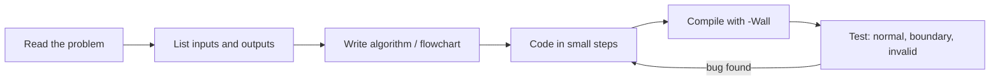

# Session 05: Practice Lab: C Basics to Conditions

> Module: Programming in C · Diploma in Cybersecurity and Digital Forensics · Term 1 · ⏱ ~2 hours

This is a hands-on practice session. There is no new theory: you will combine everything from Sessions 1 to 4 (program structure, variables, I/O, operators and decisions) to solve small problems on your own. Work through the warm-ups, then the challenges, and only then open the solution files.

## 🎯 Learning Objectives

- Plan a solution with an algorithm before typing code
- Read and validate user input with `scanf`
- Combine arithmetic, relational, logical and bitwise operators
- Choose between `if-else`, `else if` and `switch`
- Test a program with normal, boundary and invalid values
- Read and fix compiler errors and warnings

## 📖 Concepts Explained

### 1. A problem-solving routine



### 2. Compile with warnings on

```bash
gcc -Wall -Wextra program.c -o program
```

`-Wall -Wextra` asks the compiler to point out suspicious code, such as `if (x = 5)` or unused variables. Treat warnings as errors you must fix.

### 3. Testing like a security tester

| Test type | Example for "age 18-60 allowed" |
|---|---|
| Normal | 30 |
| Boundary | 17, 18, 60, 61 |
| Invalid | -5, 999, `abc` |

Attackers love boundary and invalid values. A good programmer tests them first.

### 4. Common beginner errors

| Error message (GCC) | Usual cause |
|---|---|
| `expected ';' before ...` | missing semicolon on the previous line |
| `implicit declaration of function 'printf'` | forgot `#include <stdio.h>` |
| `'x' undeclared` | variable not declared or spelled differently |
| `format '%d' expects argument of type 'int *'` | forgot `&` in `scanf` |
| `suggest parentheses around assignment` | used `=` instead of `==` |

## 💻 Code Examples

### Warm-up 1: Swap two numbers (`swap.c`)

```c
#include <stdio.h>

int main(void)
{
    int a = 5, b = 9, temp;

    temp = a;    // keep a safe
    a = b;       // a gets b
    b = temp;    // b gets old a

    printf("a = %d, b = %d\n", a, b);
    return 0;
}
```

**How it works:** a third variable holds one value while the other is copied, just like swapping two glasses of juice using an empty glass.

### Warm-up 2: Leap year (`leap_year.c`)

```c
#include <stdio.h>

int main(void)
{
    int year;
    printf("Year: ");
    if (scanf("%d", &year) != 1) { printf("Invalid\n"); return 1; }

    // divisible by 4 and not by 100, OR divisible by 400
    if ((year % 4 == 0 && year % 100 != 0) || year % 400 == 0)
        printf("%d is a leap year\n", year);
    else
        printf("%d is not a leap year\n", year);
    return 0;
}
```

**How it works:** the rule is written directly with `%`, `&&` and `||`. Test with 2024, 1900 and 2000.

### Challenge solution: Password strength (`password_score.c`)

```c
#include <stdio.h>

int main(void)
{
    int length, digits, symbols, upper;
    int score = 0;

    printf("Length, digits, symbols, uppercase letters: ");
    if (scanf("%d %d %d %d", &length, &digits, &symbols, &upper) != 4) {
        printf("Please enter four numbers.\n");
        return 1;
    }

    if (length >= 12)      score += 2;    // long passwords count most
    else if (length >= 8)  score += 1;
    if (digits > 0)  score++;
    if (symbols > 0) score++;
    if (upper > 0)   score++;

    switch (score) {
        case 5: case 4: printf("Strong (%d/5)\n", score); break;
        case 3:         printf("Medium (%d/5)\n", score); break;
        default:        printf("Weak (%d/5)\n", score);
    }
    return 0;
}
```

**How it works:** each rule adds points, then `switch` turns the score into a label. Notice `case 5: case 4:` grouped on purpose.

### Challenge solution: Electricity bill (`electricity_bill.c`)

Slab-based billing with an `else if` ladder: first 100 units at Rs 10, next 100 at Rs 15, the rest at Rs 20. See the file for the full code.

## 🧪 Lab Practice

1. **Even/odd and sign:** read an integer and print whether it is positive, negative or zero, and whether it is even or odd.
2. **Largest of three:** read three numbers and print the largest using nested `if`, then again using `&&`.
3. **Calculator menu:** read two numbers and an operator character (`+ - * /`) and use `switch` to print the result. Handle division by zero.
4. **Password score:** without opening the solution, write a program that rates a password from its length, digits, symbols and uppercase letters. Then compare with `password_score.c`.
5. **Bug hunt:** compile `buggy.c` with `-Wall`, fix all the problems, and write a comment on each line you changed.

## 📝 Assignment

**Student Result Card:** read a student's name initial (`char`), roll number and marks in three subjects (0-100). Reject invalid marks. Print total, percentage (2 decimals) and grade (A/B/C/D/F using an `else if` ladder), and "PASS" only if every subject is at least 40. Submit the `.c` file and a screenshot of three test runs (normal, boundary, invalid).

## ❓ Quick Quiz

1. Which compiler flags turn on extra warnings?
2. Give two boundary values for "marks must be 0-100".
3. What error do you get if you forget `#include <stdio.h>`?
4. What does `case 5: case 4:` do in a switch?
5. Why test invalid input such as letters for a number?

<details>
<summary>Show answers</summary>

1. `-Wall -Wextra`
2. Any of -1, 0, 100, 101
3. An implicit declaration warning/error for `printf` or `scanf`
4. Both values run the same code (intentional grouping)
5. Real users and attackers will send unexpected input; the program must handle it safely instead of misbehaving.

</details>

## 💼 Interview Questions

**1. How do you swap two variables without a third variable?**

> With arithmetic (`a = a + b; b = a - b; a = a - b;`) or XOR (`a ^= b; b ^= a; a ^= b;`). The temporary-variable method is clearer and is preferred in real code.

**2. What is boundary value testing?**

> Testing at and just around the edges of valid ranges, because off-by-one mistakes usually appear there.

**3. Why fix warnings if the program already compiles?**

> Warnings often reveal real bugs (wrong format specifier, assignment in a condition) that can cause wrong results or security issues later.

## ✅ Summary

- Follow a routine: understand, plan, code small, compile with warnings, test.
- Test normal, boundary and invalid inputs every time.
- Most beginner errors are missing semicolons, missing `&`, missing headers and `=` vs `==`.
- Sessions 1-4 together already let you build useful small tools.

---

[⬅ Previous](../Session-04-Conditions-if-else-and-switch/README.md) · [🏠 Module Home](../README.md) · [Next ➡](../Session-06-Loops-for-while-do-while/README.md)

Prepared by Zeeshan Abbas · Aptech Learning North Nazimabad
