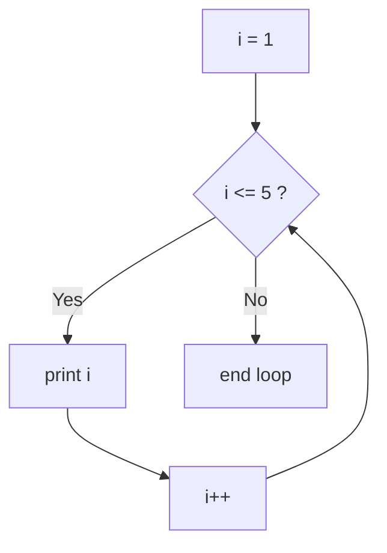

# Session 06: Loops: for, while and do-while

> Module: Programming in C · Diploma in Cybersecurity and Digital Forensics · Term 1 · ⏱ ~2 hours

Computers are great at repeating work without getting tired: scanning 1,000 ports, checking every line of a log file, or retrying a connection. In C, repetition is done with **loops**. This session covers `for`, `while` and `do-while`, the comma operator, nested loops, and how to control loops with `break`, `continue` and `exit()`.

## 🎯 Learning Objectives

- Write a counting loop with `for`
- Use the comma operator to manage two loop variables
- Build nested loops for tables and patterns
- Choose between `while` (check first) and `do-while` (run at least once)
- Control loops with `break` and `continue`
- End a program early with `exit()`

## 📖 Concepts Explained

### 1. Why loops?

Without a loop, printing 1 to 100 needs 100 `printf` lines. With a loop it needs three. Every loop has three parts:

| Part | Question it answers | Example |
|---|---|---|
| Initialisation | Where do I start? | `i = 1` |
| Condition | Should I continue? | `i <= 100` |
| Update | How do I move forward? | `i++` |

### 2. The `for` loop

```c
for (int i = 1; i <= 5; i++) {
    printf("%d ", i);      // prints 1 2 3 4 5
}
```



Use `for` when you know how many times to repeat.

### 3. The comma operator

The comma lets you put two expressions where one is expected, very handy in `for`:

```c
for (int low = 1, high = 10; low < high; low++, high--)
    printf("%d-%d ", low, high);
```

### 4. Nested loops

A loop inside a loop. The inner loop finishes all its rounds for **each** round of the outer loop. For 3 outer × 4 inner rounds, the inner body runs 12 times. Used for tables, grids and patterns.

### 5. `while` and `do-while`

| Loop | Checks condition | Runs at least once? | Typical use |
|---|---|---|---|
| `while` | before each round | No | read until a sentinel value, retry until success |
| `do-while` | after each round | Yes | menus, "ask again?" prompts |

```c
while (attempts < 3) { ... }

do {
    ...
} while (choice != 0);     // note the semicolon
```

### 6. `break`, `continue` and `exit()`

| Statement | Effect |
|---|---|
| `break` | leave the loop immediately |
| `continue` | skip the rest of this round, go to the next round |
| `exit(code)` | stop the whole program (needs `<stdlib.h>`); `exit(0)` = success, non-zero = error |

### 7. Infinite loops

`for (;;)` or `while (1)` never stops on its own; you must `break` out. A loop that is infinite by accident (forgetting `i++`) is a common bug. Press **Ctrl + C** to stop a stuck program.

## 💻 Code Examples

### Example 1: Port range listing (`for_loop.c`)

```c
#include <stdio.h>

int main(void)
{
    int start = 20, end = 25;

    for (int port = start; port <= end; port++) {
        printf("Checking port %d\n", port);
    }

    // comma operator: count up and down together
    for (int up = 1, down = 5; up <= 5; up++, down--) {
        printf("up=%d down=%d\n", up, down);
    }
    return 0;
}
```

**How it works:** the first loop counts from 20 to 25. The second uses the comma operator to move two variables at once. (It only prints; real port checking comes in the networking modules.)

### Example 2: Multiplication table with nested loops (`nested_loops.c`)

```c
#include <stdio.h>

int main(void)
{
    for (int row = 1; row <= 5; row++) {          // outer loop
        for (int col = 1; col <= 5; col++) {      // inner loop
            printf("%4d", row * col);
        }
        printf("\n");                             // new line after each row
    }
    return 0;
}
```

**How it works:** for each `row`, the inner loop prints five products; `%4d` pads each number to width 4 so columns line up.

### Example 3: PIN retry with while (`while_login.c`)

```c
#include <stdio.h>

int main(void)
{
    const int CORRECT_PIN = 2468;   // demo only
    int pin, attempts = 0;

    while (attempts < 3) {
        printf("Enter PIN: ");
        scanf("%d", &pin);
        attempts++;

        if (pin == CORRECT_PIN) {
            printf("Access granted\n");
            break;                       // stop asking
        }
        printf("Wrong PIN (%d of 3)\n", attempts);
    }

    if (attempts == 3 && pin != CORRECT_PIN)
        printf("Locked out\n");
    return 0;
}
```

**How it works:** the loop allows at most three tries; `break` ends it early on success. This is the idea behind account lockout, a defence against password guessing.

### Example 4: Menu with do-while, continue and exit (`do_while_menu.c`)

```c
#include <stdio.h>
#include <stdlib.h>

int main(void)
{
    int choice;
    do {
        printf("\n1) Odd numbers 1-10  2) Quit\nChoice: ");
        if (scanf("%d", &choice) != 1) {
            printf("Not a number. Exiting.\n");
            exit(1);                         // stop the program with error code
        }
        if (choice == 1) {
            for (int n = 1; n <= 10; n++) {
                if (n % 2 == 0) continue;    // skip even numbers
                printf("%d ", n);
            }
            printf("\n");
        }
    } while (choice != 2);

    printf("Bye\n");
    return 0;
}
```

**How it works:** the menu appears at least once. `continue` skips even numbers; `exit(1)` ends the program if input is not a number.

## 🧪 Lab Practice

1. Print the numbers 10 down to 1 with a `for` loop, then with a `while` loop.
2. Print the sum and average of the numbers 1 to 100.
3. Use nested loops to print a right triangle of `*` with 5 rows.
4. Read numbers until the user enters 0 (sentinel), then print how many were positive and negative.
5. Change `while_login.c` so the user also sees how many attempts are left.

## 📝 Assignment

Write `log_counter.c`: repeatedly read HTTP status codes (integers) until the user enters `-1`. Count how many were 2xx (success), 4xx (client error) and 5xx (server error), skip invalid codes with `continue`, and print a summary. Use a `do-while` loop.

## ❓ Quick Quiz

1. Which loop always runs at least once?
2. How many times does the inner body run in `for(i=0;i<3;i++) for(j=0;j<4;j++)`?
3. What is the difference between `break` and `continue`?
4. Which header is needed for `exit()`?
5. What happens if you forget `i++` in a `while (i < 10)` loop?

<details>
<summary>Show answers</summary>

1. `do-while`
2. 12 times
3. `break` leaves the loop; `continue` skips to the next round.
4. `<stdlib.h>`
5. The condition never changes, so it becomes an infinite loop.

</details>

## 💼 Interview Questions

**1. When would you choose `while` over `for`?**

> When the number of repetitions is not known in advance, for example reading input until a sentinel value or retrying until a connection succeeds.

**2. What is the difference between `exit(0)` and `return 0` in `main`?**

> In `main` they behave almost the same. `exit()` can be called from any function to end the whole program immediately.

**3. How does a loop help implement account lockout?**

> A counter inside a loop limits failed attempts; once the limit is reached the loop stops and the account is locked, slowing down brute-force guessing.

## ✅ Summary

- Loops have initialisation, condition and update.
- `for` for known counts, `while` for check-first, `do-while` for run-at-least-once.
- Nested loops build tables and patterns; the comma operator handles two variables.
- `break`, `continue` and `exit()` give you control over when to stop.

---

[⬅ Previous](../Session-05-Practice-Lab-C-Basics-to-Conditions/README.md) · [🏠 Module Home](../README.md) · [Next ➡](../Session-07-Functions-and-Storage-Classes/README.md)

Prepared by Zeeshan Abbas · Aptech Learning North Nazimabad
