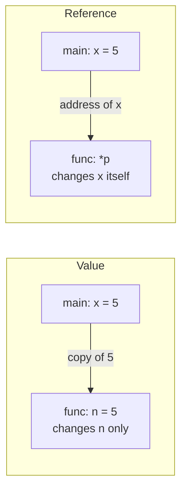

# Session 07: Functions and Storage Classes

> Module: Programming in C · Diploma in Cybersecurity and Digital Forensics · Term 1 · ⏱ ~2 hours

As programs grow, putting everything in `main()` becomes messy. **Functions** let you split a program into small named pieces, each doing one job: `isValidPort()`, `hashPassword()`, `printReport()`. This session covers how to write and call functions, passing data by value and by reference, scope, storage classes, multi-file programs and function pointers.

## 🎯 Learning Objectives

- Explain why functions are used and identify the parts of a function
- Write function prototypes (declarations) and definitions
- Tell local, global and formal (parameter) variables apart
- Call functions by value and by reference (with pointers)
- Describe scope rules and the storage classes `auto`, `static`, `extern`, `register`
- Split a program into several files and use a function pointer

## 📖 Concepts Explained

### 1. Why use functions?

- **Reuse:** write once, call many times.
- **Readability:** `if (isValidPort(p))` reads like English.
- **Testing:** small functions are easy to test.
- **Teamwork:** different people can write different functions.

### 2. Structure of a function

```c
int add(int a, int b)     // return type, name, parameters
{
    int sum = a + b;      // body
    return sum;           // send a value back
}
```

| Part | Meaning |
|---|---|
| Return type | type of value sent back (`void` = nothing) |
| Name | how you call it |
| Parameters | inputs received (formal parameters) |
| Body | the statements inside `{ }` |
| `return` | ends the function and sends back a value |

### 3. Declaration (prototype) vs definition

A **prototype** tells the compiler a function exists before it is used:

```c
int add(int a, int b);    // prototype, ends with ;
```

Put prototypes at the top (or in a `.h` header file) and definitions below `main` or in another `.c` file.

### 4. Types of variables

| Kind | Declared | Visible | Lifetime |
|---|---|---|---|
| Local | inside a function/block | only there | while the block runs |
| Formal parameter | in the function header | inside that function | during the call |
| Global | outside all functions | whole file (and other files with `extern`) | whole program |

Prefer locals; globals make bugs harder to trace.

### 5. Call by value vs call by reference



- **By value:** the function gets a copy; the original does not change.
- **By reference:** the function gets the **address** (a pointer) and can change the original. C does this with `*` and `&`.

### 6. Scope rules

A name is visible from where it is declared to the end of its block. An inner variable with the same name **hides** the outer one. Two functions can each have a local `i` without conflict.

### 7. Storage classes

| Keyword | Where | Effect |
|---|---|---|
| `auto` | local (default) | created and destroyed with each call |
| `static` (local) | inside a function | keeps its value between calls |
| `static` (global) | outside functions | visible only in this file (hides it from others) |
| `extern` | declaration | "this variable is defined in another file" |
| `register` | local | hint to keep in a CPU register (modern compilers decide themselves) |

### 8. Multi-file programs

```
main.c       -> calls isValidPort()
utils.h      -> prototype: int isValidPort(int port);
utils.c      -> definition of isValidPort()
```

Compile together: `gcc main.c utils.c -o app`.

### 9. Function pointers

A function has an address too. A **function pointer** stores it so you can choose at run time which function to call, e.g. picking an operation from a menu or registering a callback.

```c
int (*op)(int, int) = add;   // op points to add
int r = op(2, 3);            // calls add(2, 3)
```

## 💻 Code Examples

### Example 1: Prototype, definition and call (`functions_basic.c`)

```c
#include <stdio.h>

int isValidPort(int port);          // prototype

int main(void)
{
    int ports[] = {80, 70000, 443, -1};
    for (int i = 0; i < 4; i++) {
        printf("%d -> %s\n", ports[i],
               isValidPort(ports[i]) ? "valid" : "invalid");
    }
    return 0;
}

int isValidPort(int port)           // definition
{
    return port >= 0 && port <= 65535;   // 1 or 0
}
```

**How it works:** `main` uses the function before its body appears, which is allowed because of the prototype.

### Example 2: By value vs by reference (`swap_value_reference.c`)

```c
#include <stdio.h>

void swapByValue(int a, int b)       // gets copies
{
    int t = a; a = b; b = t;
}

void swapByReference(int *a, int *b) // gets addresses
{
    int t = *a; *a = *b; *b = t;
}

int main(void)
{
    int x = 1, y = 2;
    swapByValue(x, y);
    printf("After by value    : x=%d y=%d\n", x, y);   // 1 2
    swapByReference(&x, &y);
    printf("After by reference: x=%d y=%d\n", x, y);   // 2 1
    return 0;
}
```

**How it works:** only the version that receives addresses (`&x`, `&y`) can change the caller's variables.

### Example 3: `static` keeps a count (`storage_classes.c`)

```c
#include <stdio.h>

void logEvent(void)
{
    static int count = 0;   // created once, keeps its value
    int temp = 0;           // auto: fresh every call
    count++; temp++;
    printf("event #%d (temp=%d)\n", count, temp);
}

int main(void)
{
    logEvent(); logEvent(); logEvent();
    return 0;
}
```

**How it works:** `count` goes 1, 2, 3 while `temp` is always 1.

### Example 4: Multi-file program (`multifile/`)

Folder `multifile/` contains `main.c`, `utils.h` and `utils.c`. Build with `gcc main.c utils.c -o portcheck`.

### Example 5: Function pointer menu (`function_pointer.c`)

See the file: `add` or `multiply` is chosen at run time and called through one pointer.

## 🧪 Lab Practice

1. Write `int square(int n)` and print the squares of 1-10.
2. Remove the prototype from `functions_basic.c` and read the compiler warning. Put it back.
3. Write `void addBonus(int *marks)` that adds 5 marks through a pointer; prove the change in `main`.
4. Build the `multifile` project. Add a new function `isWellKnownPort()` (0-1023) to `utils.c`/`utils.h` and use it.
5. Add a `subtract` option to `function_pointer.c`.

## 📝 Assignment

Write `atm.c` with functions `showBalance(double balance)`, `deposit(double *balance, double amount)` and `withdraw(double *balance, double amount)` (refuse if not enough money). Use a `static` counter inside a `logTransaction()` function to number each transaction. Drive it from a `do-while` menu in `main`.

## ❓ Quick Quiz

1. What does a function with return type `void` return?
2. Why do we need a prototype?
3. Which call can change the caller's variable: by value or by reference?
4. What does `static` do to a local variable?
5. Which keyword says "this global is defined in another file"?

<details>
<summary>Show answers</summary>

1. Nothing
2. So the compiler knows the function's name, return type and parameters before it is called.
3. By reference (passing the address)
4. It keeps its value between calls (lifetime = whole program).
5. `extern`

</details>

## 💼 Interview Questions

**1. What is the difference between a parameter and an argument?**

> A parameter is the variable in the function definition; an argument is the actual value passed when calling it.

**2. Does C support call by reference?**

> Strictly C always passes by value, but passing a pointer (an address) by value lets the function change the original, which gives the effect of call by reference.

**3. Where are function pointers used?**

> Callbacks (`qsort` comparator), event handlers, plugin systems and jump tables in interpreters and network packet handlers.

## ✅ Summary

- Functions break programs into reusable, testable pieces.
- Declare with a prototype, define the body, call with arguments.
- By value copies data; by reference (pointers) lets a function change the original.
- Scope and storage classes decide where a variable is visible and how long it lives.
- Large programs use several `.c` files plus `.h` headers; function pointers choose behaviour at run time.

---

[⬅ Previous](../Session-06-Loops-for-while-do-while/README.md) · [🏠 Module Home](../README.md) · [Next ➡](../Session-08-Arrays-and-Strings/README.md)

Prepared by Zeeshan Abbas · Aptech Learning North Nazimabad
