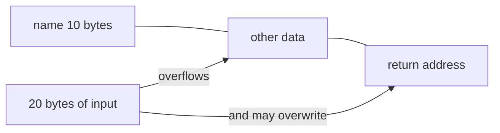

# Session 08: Arrays and Strings

> Module: Programming in C · Diploma in Cybersecurity and Digital Forensics · Term 1 · ⏱ ~2 hours

An **array** stores many values of the same type under one name: the marks of 40 students, the last 100 login times, the bytes of a network packet. Strings in C are simply arrays of characters. This session also shows why writing past the end of an array is one of the most famous security bugs in history: the **buffer overflow**.

## 🎯 Learning Objectives

- Explain array elements, indices and the zero-based rule
- Declare, initialise and process arrays with loops
- Work with strings (character arrays) and `<string.h>` functions
- Read strings safely with `fgets`
- Declare and initialise two-dimensional arrays
- Explain what a buffer overflow is and how to avoid it

## 📖 Concepts Explained

### 1. What is an array?

```c
int marks[5] = {70, 85, 90, 60, 75};
```

| Index | 0 | 1 | 2 | 3 | 4 |
|---|---|---|---|---|---|
| Value | 70 | 85 | 90 | 60 | 75 |

- All elements have the same type and sit next to each other in memory.
- Indices start at **0**, so the last index is `size - 1`.
- `marks[2]` is 90. `marks[5]` does **not** exist.

> **Analogy:** an array is a row of numbered lockers. The row has one name; each locker has a number starting from 0.

### 2. Declaring and initialising

```c
int a[5];                    // 5 ints, values unknown (garbage)
int b[5] = {1, 2, 3};        // rest become 0 -> 1 2 3 0 0
int c[]  = {4, 5, 6};        // size worked out: 3
int zeros[100] = {0};        // all 100 set to 0
```

Size of an array: `sizeof(c) / sizeof(c[0])`.

### 3. Processing arrays with loops

A `for` loop from `0` to `size - 1` visits every element: to read input, add totals, find the maximum, or search for a value.

### 4. Strings are character arrays

A C string is a `char` array that ends with the special **null character** `'\0'`.

```c
char user[6] = "admin";      // a d m i n \0  -> needs 6 slots
```

| Function (`<string.h>`) | Purpose |
|---|---|
| `strlen(s)` | length, not counting `\0` |
| `strcpy(d, s)` / `strncpy` | copy |
| `strcat(d, s)` / `strncat` | join |
| `strcmp(a, b)` | compare: 0 means equal |
| `snprintf(d, size, ...)` | safe formatted write into a buffer |

Reading a whole line safely: `fgets(buffer, sizeof buffer, stdin);` It never writes more than the buffer size.

### 5. Buffer overflow: why bounds matter

C does **not** check array bounds. Writing `name[20]` when `name` has 10 slots overwrites whatever lies next in memory. Attackers have used this to crash programs or run their own code (for example the 1988 Morris worm abused an unchecked read in `fingerd`).



**Safe habits:** use `fgets` not `gets` (removed from C), use `strncpy`/`snprintf` with sizes, always loop with `i < size`.

### 6. Two-dimensional arrays

A table with rows and columns:

```c
int lab[2][3] = {
    {1, 0, 1},     // row 0
    {0, 1, 1}      // row 1
};
```

`lab[1][2]` is row 1, column 2 = 1. Process with nested loops (row outside, column inside). Multidimensional arrays follow the same idea: `int cube[2][3][4];`.

## 💻 Code Examples

### Example 1: Marks statistics (`array_basics.c`)

```c
#include <stdio.h>

int main(void)
{
    int marks[5] = {70, 85, 90, 60, 75};
    int size = sizeof(marks) / sizeof(marks[0]);
    int total = 0, highest = marks[0];

    for (int i = 0; i < size; i++) {
        total += marks[i];                 // add each element
        if (marks[i] > highest)
            highest = marks[i];            // remember the biggest
    }

    printf("Total   : %d\n", total);
    printf("Average : %.2f\n", (double)total / size);
    printf("Highest : %d\n", highest);
    return 0;
}
```

**How it works:** one loop visits each element once, updating the total and the highest value.

### Example 2: Linear search for a blocked IP octet (`search_array.c`)

```c
#include <stdio.h>

int main(void)
{
    int blocked[] = {13, 47, 99, 120, 201};
    int size = sizeof(blocked) / sizeof(blocked[0]);
    int target, found = 0;

    printf("Last octet to check: ");
    if (scanf("%d", &target) != 1) return 1;

    for (int i = 0; i < size; i++) {
        if (blocked[i] == target) {
            printf("Blocked (found at index %d)\n", i);
            found = 1;
            break;
        }
    }
    if (!found) printf("Allowed\n");
    return 0;
}
```

**How it works:** each element is compared until a match is found; `break` stops early.

### Example 3: Safe string handling (`strings_safe.c`)

```c
#include <stdio.h>
#include <string.h>

int main(void)
{
    char username[16];

    printf("Username: ");
    if (fgets(username, sizeof username, stdin) == NULL) return 1;
    username[strcspn(username, "\n")] = '\0';   // remove the newline

    printf("Length: %zu\n", strlen(username));

    if (strcmp(username, "admin") == 0)
        printf("Warning: default admin account used!\n");

    char greeting[32];
    snprintf(greeting, sizeof greeting, "Hello, %s", username);  // never overflows
    printf("%s\n", greeting);
    return 0;
}
```

**How it works:** `fgets` reads at most 15 characters + `\0`, `strcspn` finds the newline so we can cut it, and `snprintf` writes safely within 32 bytes.

### Example 4: 2D array lab seats (`two_d_array.c`)

The file prints a 3 × 4 grid of lab seats (1 = occupied) and counts free seats with nested loops.

## 🧪 Lab Practice

1. Read 5 temperatures into an array and print them in reverse order.
2. Extend `array_basics.c` to also print the lowest mark and how many marks are above average.
3. Count the vowels in a word read with `fgets`.
4. In `two_d_array.c`, add the total of each row.
5. **Think like a defender:** in `strings_safe.c` type a 30-character username. What happens, and why is nothing overwritten?

## 📝 Assignment

Write `password_check.c`: read a password with `fgets` into a 64-byte buffer. Loop through its characters and count uppercase letters, lowercase letters, digits and symbols (use `isupper`, `islower`, `isdigit` from `<ctype.h>`). Print "Strong" only if length ≥ 12 and every category count is at least 1.

## ❓ Quick Quiz

1. What is the index of the last element of `int a[10]`?
2. How many bytes does `char s[] = "cyber";` use?
3. What does `strcmp(a, b)` return when the strings are equal?
4. Why is `fgets` safer than the old `gets`?
5. In `int t[3][4]`, how many elements are there?

<details>
<summary>Show answers</summary>

1. 9
2. 6 (five letters plus `'\0'`)
3. 0
4. `fgets` takes the buffer size and never writes past it; `gets` had no limit and was removed from the standard.
5. 12

</details>

## 💼 Interview Questions

**1. What is a buffer overflow?**

> Writing more data into a buffer than it can hold, so the extra bytes overwrite neighbouring memory. It can crash a program or let an attacker change its behaviour.

**2. Why does C not check array bounds?**

> For speed and simplicity; C trusts the programmer. That is why bounds must be checked in code and why safer functions and compiler protections exist.

**3. What is the difference between `'A'` and `"A"`?**

> `'A'` is a single `char`; `"A"` is a string of two bytes: `'A'` and `'\0'`.

## ✅ Summary

- Arrays hold many same-type values; indices run from 0 to size - 1.
- Loops process arrays: totals, maximum, search.
- Strings are `char` arrays ending in `'\0'`; use `<string.h>` and size-aware functions.
- 2D arrays are tables processed with nested loops.
- Never write past the end of an array: that is a buffer overflow.

---

[⬅ Previous](../Session-07-Functions-and-Storage-Classes/README.md) · [🏠 Module Home](../README.md) · [Next ➡](../Session-09-Pointers-and-Memory/README.md)

Prepared by Zeeshan Abbas · Aptech Learning North Nazimabad
