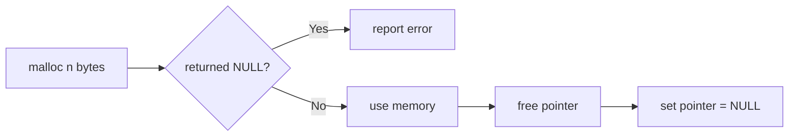

# Session 09: Pointers and Memory

> Module: Programming in C · Diploma in Cybersecurity and Digital Forensics · Term 1 · ⏱ ~2 hours

Pointers are the feature that makes C powerful and, if misused, dangerous. A pointer holds a **memory address**. Operating systems, drivers, network stacks and exploit code all use pointers heavily, and many vulnerabilities (use-after-free, null dereference, overflows) are pointer mistakes. Take this session slowly and draw memory boxes on paper.

## 🎯 Learning Objectives

- Explain what a pointer is and where pointers are used
- Declare pointer variables and use the `&` and `*` operators
- Assign values to pointers, including `NULL`
- Perform pointer arithmetic and pointer comparisons
- Pass pointers to functions and use pointers with 1D and 2D arrays
- Allocate and free memory dynamically with `malloc` and `free`

## 📖 Concepts Explained

### 1. Memory and addresses

Every variable lives in memory at an **address** (a number, usually shown in hex like `0x7ffd5c`).

| Variable | Value | Address (example) |
|---|---|---|
| `int age` | 21 | `0x1000` |
| `int *p` | `0x1000` | `0x2000` |

`p` is a pointer: its value is the address of `age`.

> **Analogy:** a variable is a house; its address is written on a piece of paper. A pointer is that piece of paper. With it you can find the house and change what is inside.

### 2. The two pointer operators

| Operator | Name | Meaning | Example |
|---|---|---|---|
| `&` | address-of | "where is it?" | `p = &age;` |
| `*` | dereference | "what is at that address?" | `*p = 30;` changes `age` |

In a declaration `int *p;` the `*` means "p is a pointer to int".

### 3. Assigning pointers

```c
int x = 5;
int *p = &x;      // p points to x
int *q = p;       // q points to the same place
int *r = NULL;    // points to nothing (safe "empty" value)
```

Always initialise pointers. An uninitialised pointer holds a random address; using it can crash the program. Check `if (r != NULL)` before using `*r`.

### 4. Pointer arithmetic

Adding 1 to a pointer moves it to the **next element**, not the next byte. For `int *p` (4-byte ints), `p + 1` is 4 bytes further.

| Operation | Allowed? |
|---|---|
| `p + n`, `p - n`, `p++`, `p--` | yes |
| `p2 - p1` (same array) | yes: number of elements between |
| `p1 + p2`, `p * 2` | no |

### 5. Pointer comparisons

`p1 == p2` (same address), `p1 < p2` (earlier in the same array). Comparisons are meaningful only for pointers into the same array.

### 6. Pointers as function arguments

Passing `&x` lets a function change `x` (you saw this with `swapByReference`). Functions like `scanf` work this way.

### 7. Pointers and arrays

An array name behaves like a pointer to its first element:

```c
int a[3] = {10, 20, 30};
int *p = a;          // same as &a[0]
// a[i]  is the same as  *(a + i)  and  p[i]
```

For a 2D array `int m[2][3]`, `m[i][j]` is the same as `*(*(m + i) + j)`. Each `m[i]` is a row (an array of 3 ints).

### 8. Dynamic memory allocation

Sometimes the size is known only at run time. Use `<stdlib.h>`:



| Function | Purpose |
|---|---|
| `malloc(bytes)` | allocate uninitialised memory |
| `calloc(n, size)` | allocate and set to zero |
| `realloc(p, bytes)` | resize |
| `free(p)` | give memory back |

**Bugs to avoid:** memory leak (forgetting `free`), use-after-free (using memory after `free`), double free. Setting the pointer to `NULL` after `free` helps.

## 💻 Code Examples

### Example 1: Pointer basics (`pointer_basics.c`)

```c
#include <stdio.h>

int main(void)
{
    int age = 21;
    int *p = &age;                  // p stores the address of age

    printf("age        = %d\n", age);
    printf("&age       = %p\n", (void *)&age);
    printf("p          = %p\n", (void *)p);
    printf("*p         = %d\n", *p);   // value at that address

    *p = 30;                        // change age through the pointer
    printf("age is now = %d\n", age);
    return 0;
}
```

**How it works:** `p` and `&age` print the same address; `*p = 30` changes `age` without naming it.

### Example 2: Walking an array with pointer arithmetic (`pointer_arithmetic.c`)

```c
#include <stdio.h>

int main(void)
{
    int bytes[5] = {192, 168, 1, 10, 0};
    int *start = bytes;             // first element
    int *end = bytes + 4;           // last element

    for (int *p = start; p <= end; p++) {    // pointer comparison
        printf("address %p holds %d\n", (void *)p, *p);
    }
    printf("Elements from start to end: %td\n", end - start + 1);
    return 0;
}
```

**How it works:** `p++` jumps one `int` each time; the addresses increase by 4. `end - start` counts elements.

### Example 3: Sum an array through a function (`pointer_function.c`)

```c
#include <stdio.h>

int sumArray(const int *arr, int size)   // const: we will not change it
{
    int total = 0;
    for (int i = 0; i < size; i++)
        total += *(arr + i);             // same as arr[i]
    return total;
}

int main(void)
{
    int scores[] = {4, 8, 15, 16, 23};
    printf("Sum = %d\n", sumArray(scores, 5));
    return 0;
}
```

**How it works:** the array is passed as a pointer to its first element, so the function must also receive the size.

### Example 4: Dynamic array (`dynamic_memory.c`)

```c
#include <stdio.h>
#include <stdlib.h>

int main(void)
{
    int count;
    printf("How many ports? ");
    if (scanf("%d", &count) != 1 || count <= 0 || count > 1000) return 1;

    int *ports = malloc(count * sizeof(int));   // ask for memory
    if (ports == NULL) {
        printf("Out of memory\n");
        return 1;
    }

    for (int i = 0; i < count; i++)
        ports[i] = 8000 + i;                    // fill it

    for (int i = 0; i < count; i++)
        printf("%d ", ports[i]);
    printf("\n");

    free(ports);        // give memory back
    ports = NULL;       // avoid use-after-free
    return 0;
}
```

**How it works:** the size is limited (1-1000) before allocating, `malloc` is checked for `NULL`, and memory is freed when done.

### Example 5: 2D array with pointers (`pointer_2d.c`)

The file prints a 2 × 3 matrix using both `m[i][j]` and `*(*(m + i) + j)` to show they are the same.

## 🧪 Lab Practice

1. Declare `double price = 99.5;` and a pointer to it. Increase the price by 10% through the pointer.
2. Run `pointer_arithmetic.c` and note how much the address grows each step. Change the array to `char` and compare.
3. Write `void toUpper(char *s)` that converts a string to uppercase by moving a pointer until `'\0'`.
4. Change `dynamic_memory.c` to use `calloc` and print the values before filling them.
5. Write `int *findMax(int *arr, int size)` that returns a pointer to the largest element.

## 📝 Assignment

Write `reverse_string.c`: read a line with `fgets`, then reverse it **in place** using two pointers (`left` at the start, `right` at the end) that swap characters and move towards each other until they meet. Do not use array indexing `[]` inside the reverse function.

## ❓ Quick Quiz

1. What does `&x` give?
2. If `int *p = &x;`, what does `*p = 7;` do?
3. For `int *p`, how many bytes does `p + 1` move on a system with 4-byte ints?
4. What should you always check after `malloc`?
5. What is a memory leak?

<details>
<summary>Show answers</summary>

1. The address of `x`
2. Stores 7 in `x`
3. 4 bytes (one `int`)
4. That it did not return `NULL`
5. Allocated memory that is never freed, so the program keeps using more memory.

</details>

## 💼 Interview Questions

**1. What is a NULL pointer and a dangling pointer?**

> A NULL pointer points to nothing on purpose. A dangling pointer still holds the address of memory that has been freed or gone out of scope; using it is undefined behaviour.

**2. What is use-after-free and why is it a security issue?**

> Using memory after calling `free` on it. An attacker may arrange for that memory to be reused with their data, leading to crashes or code execution.

**3. Difference between an array name and a pointer?**

> Both can be used to access elements, but an array name is a fixed address (cannot be reassigned) and `sizeof` gives the whole array size; a pointer is a variable that can point elsewhere.

## ✅ Summary

- A pointer stores an address; `&` gets an address, `*` uses it.
- Initialise pointers, use `NULL` for "nothing", check before dereferencing.
- Pointer arithmetic moves by whole elements; arrays and pointers are closely linked.
- `malloc`/`free` give run-time memory; always check, always free, then set to `NULL`.

---

[⬅ Previous](../Session-08-Arrays-and-Strings/README.md) · [🏠 Module Home](../README.md) · [Next ➡](../Session-10-Practice-Lab-Loops-to-Pointers/README.md)

Prepared by Zeeshan Abbas · Aptech Learning North Nazimabad
