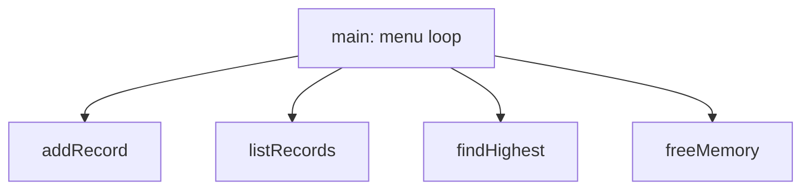

# Session 10: Practice Lab: Loops to Pointers

> Module: Programming in C · Diploma in Cybersecurity and Digital Forensics · Term 1 · ⏱ ~2 hours

The final practice session of the module brings together loops, functions, arrays, strings and pointers. You will build small but realistic tools a security learner might write: a log analyser, a Caesar cipher, a simple checksum and a menu-driven student record system. Try each task yourself before reading the solution files.

## 🎯 Learning Objectives

- Combine loops, functions, arrays and pointers in one program
- Design a program as a set of small functions
- Process strings character by character
- Use dynamic memory safely
- Debug with `printf` tracing and compiler warnings
- Prepare for the module's practical exam

## 📖 Concepts Explained

### 1. Designing with functions

Before coding, list the jobs your program must do and give each a function:



Each function should do **one** thing and have a clear name, inputs and output.

### 2. Character processing toolkit (`<ctype.h>`)

| Function | Returns true for |
|---|---|
| `isalpha(c)` | letters |
| `isdigit(c)` | digits 0-9 |
| `isupper(c)` / `islower(c)` | upper / lower case |
| `isspace(c)` | space, tab, newline |
| `toupper(c)` / `tolower(c)` | converted character |

### 3. Classical ciphers vs real encryption

A **Caesar cipher** shifts each letter by a fixed number (A→D for shift 3). It is a great exercise in loops and characters, but it is **not secure**: there are only 25 possible keys, so it can be broken instantly. Real systems use algorithms such as AES, covered later in the diploma.

### 4. Checksums

A **checksum** is a small number calculated from data to detect accidental changes. Our simple version adds all byte values and takes the remainder by 256. Real integrity checks use cryptographic hashes such as SHA-256.

### 5. Debugging tips

| Technique | How |
|---|---|
| Trace prints | `printf("DEBUG i=%d sum=%d\n", i, sum);` inside loops |
| Warnings | `gcc -Wall -Wextra -g` |
| Small inputs | test with 2-3 items before 100 |
| Rubber duck | explain each line out loud; the bug often appears |
| Debugger | `gdb ./program` then `break main`, `run`, `next`, `print var` |

## 💻 Code Examples

### Solution 1: Caesar cipher (`caesar_cipher.c`)

```c
#include <stdio.h>
#include <string.h>
#include <ctype.h>

// shift letters forward by key places, keep other characters
void encrypt(char *text, int key)
{
    for (char *p = text; *p != '\0'; p++) {
        if (isupper((unsigned char)*p))
            *p = (char)('A' + (*p - 'A' + key) % 26);
        else if (islower((unsigned char)*p))
            *p = (char)('a' + (*p - 'a' + key) % 26);
    }
}

int main(void)
{
    char message[100];
    int key = 3;

    printf("Message: ");
    if (fgets(message, sizeof message, stdin) == NULL) return 1;
    message[strcspn(message, "\n")] = '\0';

    encrypt(message, key);
    printf("Encrypted: %s\n", message);

    encrypt(message, 26 - key);          // shifting back decrypts
    printf("Decrypted: %s\n", message);
    return 0;
}
```

**How it works:** a pointer walks the string; letters are moved `key` places with `% 26` wrapping Z back to A. Shifting by `26 - key` undoes it.

### Solution 2: Log level counter (`log_analyzer.c`)

```c
#include <stdio.h>
#include <string.h>

int main(void)
{
    const char *logs[] = {
        "INFO user login", "WARN disk 85%", "ERROR db timeout",
        "INFO user logout", "ERROR failed login", "INFO backup done"
    };
    int count = sizeof(logs) / sizeof(logs[0]);
    int info = 0, warn = 0, error = 0;

    for (int i = 0; i < count; i++) {
        if (strncmp(logs[i], "INFO", 4) == 0)       info++;
        else if (strncmp(logs[i], "WARN", 4) == 0)  warn++;
        else if (strncmp(logs[i], "ERROR", 5) == 0) error++;
    }

    printf("INFO: %d  WARN: %d  ERROR: %d\n", info, warn, error);
    return 0;
}
```

**How it works:** an array of string pointers holds log lines; `strncmp` checks only the first characters to classify each line.

### Solution 3: Simple checksum (`checksum.c`)

Reads a line and prints the sum of its bytes modulo 256. Change one letter and see the checksum change.

### Solution 4: Student records (`student_records.c`)

A menu program that asks how many students, allocates an array with `malloc`, reads names and marks through functions, prints a table, shows the topper, and frees memory at the end. See the file.

## 🧪 Lab Practice

1. **Prime numbers:** write `int isPrime(int n)` and print all primes from 1 to 100.
2. **Caesar:** run `caesar_cipher.c`, then write a "brute force" loop that prints the message decrypted with all 25 keys. Which one is readable?
3. **Word count:** count words in a line (count transitions from space to non-space).
4. **Log analyser:** add a `DEBUG` level and print the percentage of each level.
5. **Records:** in `student_records.c`, add an option to search a student by name with `strcmp`.

## 📝 Assignment

**Mini-project: Login Audit Tool.** Store 8 login records in arrays (`username[8][20]` and `success[8]` as 1/0). Write functions to: print all records, count failures per user, and list users with 3 or more failures as "suspicious". Use at least one pointer parameter and one loop with `break` or `continue`. Submit code, sample output and a one-paragraph explanation.

## ❓ Quick Quiz

1. Why is the Caesar cipher not secure?
2. What does `% 26` do in the cipher?
3. Which function compares only the first n characters of two strings?
4. What must you do with memory from `malloc` before the program ends?
5. Name one way to find a logic bug in a loop.

<details>
<summary>Show answers</summary>

1. There are only 25 keys, so every possibility can be tried in a moment (brute force).
2. It wraps the position around so that after Z you return to A.
3. `strncmp`
4. Release it with `free`.
5. Add trace `printf`s, use a debugger such as gdb, or test with very small inputs.

</details>

## 💼 Interview Questions

**1. How would you design a C program that processes a large log file?**

> Read it line by line with `fgets` into a fixed buffer, parse each line with small functions, keep counters or a dynamically sized array, and free everything at the end.

**2. What is the difference between a checksum and a cryptographic hash?**

> A checksum detects accidental changes and is easy to forge. A cryptographic hash (SHA-256) is designed so that finding two inputs with the same hash is practically impossible.

**3. What does `-g` do when compiling?**

> It adds debugging information so tools like gdb can show source lines and variable names.

## ✅ Summary

- Real programs combine loops, functions, arrays, strings and pointers.
- Plan with small functions, test with small inputs, compile with warnings.
- Classical ciphers and simple checksums are learning tools, not real security.
- You are now ready for the module exam and for reading C code in security tools.

---

[⬅ Previous](../Session-09-Pointers-and-Memory/README.md) · [🏠 Module Home](../README.md)

Prepared by Zeeshan Abbas · Aptech Learning North Nazimabad
