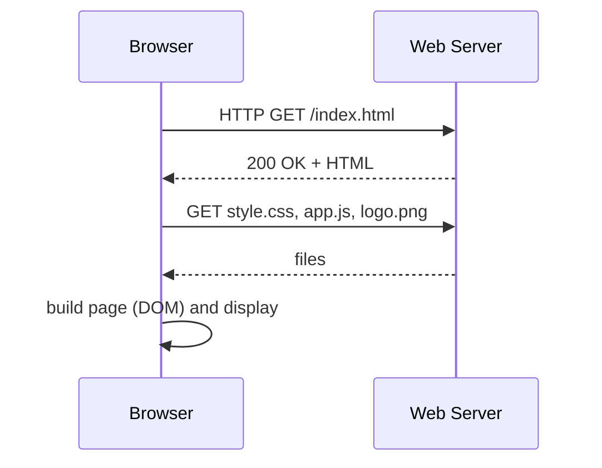

# Session 01: Introduction to the Web and HTML5

> Module: Client-Side Scripting with HTML5 and JavaScript · Diploma in Cybersecurity and Digital Forensics · Term 1 · ⏱ ~2 hours

Almost every attack surface today has a web page in front of it: login portals, admin panels, router dashboards. To test or defend them you must first understand how a page is built. This session introduces the web, the history of HTML, and the building blocks of an HTML5 document.

## 🎯 Learning Objectives

- Describe how a browser gets and shows a web page
- Outline the evolution of HTML up to HTML5 and the role of CSS, JavaScript and jQuery
- Write a valid HTML5 page with `<!DOCTYPE html>`, `<head>` and `<body>`
- Identify the parts of a tag: element, attribute, value
- Tell container tags from standalone (void) tags and use HTML entities
- Explain why HTML5 matters for mobile devices

## 📖 Concepts Explained

### 1. How the web works



The browser asks for a page, the server returns HTML, the browser then fetches CSS, JavaScript and images, and draws the result.

### 2. The three layers of a page

| Layer | Language | Job | Analogy |
|---|---|---|---|
| Structure | HTML | headings, paragraphs, forms | the bricks of a house |
| Presentation | CSS | colours, fonts, layout | paint and furniture |
| Behaviour | JavaScript | clicks, validation, updates | electricity and switches |

**jQuery** is a JavaScript library (2006) that made DOM work easier across old browsers. Modern JavaScript can do most of it natively, but you will still meet jQuery in many existing sites.

### 3. Evolution of HTML

| Year | Version | Highlight |
|---|---|---|
| 1991 | HTML (Tim Berners-Lee) | links and simple text |
| 1995-1997 | HTML 2.0, 3.2 | forms, tables |
| 1999 | HTML 4.01 | CSS support, scripting |
| 2000 | XHTML 1.0 | stricter XML rules |
| 2014 | HTML5 (W3C) | semantic tags, audio/video, canvas, storage |
| now | HTML Living Standard (WHATWG) | continuously updated |

### 4. New features in HTML5

Semantic tags (`<header>`, `<nav>`, `<article>`), native `<audio>` and `<video>`, `<canvas>` drawing, new form inputs (`email`, `date`, `range`), local storage, geolocation, drag-and-drop, and better mobile support. All modern browsers (Chrome, Edge, Firefox, Safari) support them.

### 5. Anatomy of a tag

```html
<a href="https://www.aptech-education.com.pk" target="_blank">Visit</a>
```

| Part | Example |
|---|---|
| Opening tag | `<a ...>` |
| Attribute name = value | `href="https://..."` |
| Content | `Visit` |
| Closing tag | `</a>` |
| Element | the whole thing from `<a` to `</a>` |

### 6. Container vs standalone tags

| Container (has content and closing tag) | Standalone / void (no closing tag) |
|---|---|
| `<p>...</p>`, `<h1>...</h1>`, `<div>...</div>` | `<br>`, `<hr>`, ``, `<input>`, `<meta>` |

### 7. DOCTYPE and basic structure

`<!DOCTYPE html>` tells the browser to use standards mode. Then `<html lang="en">` wraps everything, `<head>` holds information about the page (title, charset, viewport), and `<body>` holds what users see.

### 8. Data types, attributes and entities

Attribute values have types: text (`alt="logo"`), URL (`src`), number (`width="200"`), boolean (`required`, `disabled`), and enumerated (`type="email"`). **Global attributes** work on any element: `id`, `class`, `style`, `title`, `lang`, `hidden`.

**Entities** show reserved characters: `&lt;` (<), `&gt;` (>), `&amp;` (&), `&quot;` ("), `&copy;` (©), `&nbsp;` (non-breaking space).

> 🔐 **Security link:** escaping `<` and `>` as entities is exactly how websites stop **cross-site scripting (XSS)**: user text is shown as text, not run as code.

### 9. HTML5 and mobile

The viewport meta tag `<meta name="viewport" content="width=device-width, initial-scale=1">` makes pages fit phone screens. HTML5 replaced plug-ins like Flash, so media works on phones without extra software.

## 💻 Code Examples

### Example 1: First HTML5 page (`index.html`)

```html
<!DOCTYPE html>
<html lang="en">
<head>
  <meta charset="UTF-8">                     <!-- support all characters -->
  <meta name="viewport" content="width=device-width, initial-scale=1">
  <title>My First Page</title>              <!-- shown on the browser tab -->
</head>
<body>
  <h1>Welcome to Cyber Security</h1>
  <p>This is my <strong>first</strong> HTML5 page.</p>
  <hr>                                       <!-- standalone tag -->
  <p>Contact: student@example.com</p>
</body>
</html>
```

**How it works:** the head holds settings, the body holds visible content. Open the file in a browser by double-clicking it.

### Example 2: Entities and attributes (`entities.html`)

```html
<p>To write a tag as text use &lt;script&gt; instead of the real thing.</p>
<p title="Tooltip text">Hover over me.</p>
<p>Fish &amp; Chips &copy; 2026</p>
<input type="text" placeholder="Your name" required>
```

**How it works:** entities print `<`, `>`, `&` and `©` safely; `title` and `required` are attributes.

## 🧪 Lab Practice

1. Install VS Code and the **Live Server** extension. Open `index.html` with Live Server.
2. Right-click the page → **View page source**, then press **F12** to open Developer Tools and find the `<h1>` in the Elements panel.
3. Remove `<!DOCTYPE html>` and check the Console for a "Quirks Mode" warning. Put it back.
4. Add your name, batch and three hobbies to the page using `<p>` and `<br>`.
5. Run your page through the [W3C validator](https://validator.w3.org/#validate_by_input) and fix any errors.

## 📝 Assignment

Create `about-me.html`: a valid HTML5 page with a proper head (charset, viewport, title), a heading, two paragraphs, a horizontal rule, and a line that displays the text `<b>not bold</b>` literally using entities. Validate it and submit a screenshot of the "no errors" result.

## ❓ Quick Quiz

1. Which layer of a page does CSS handle?
2. What does `<!DOCTYPE html>` do?
3. Name two standalone (void) tags.
4. Which entity displays `<`?
5. What does the viewport meta tag do?

<details>
<summary>Show answers</summary>

1. Presentation (look and layout)
2. Tells the browser to render the page in standards mode as HTML5.
3. Any two of `<br>`, `<hr>`, ``, `<input>`, `<meta>`
4. `&lt;`
5. Makes the page width match the device screen so it displays correctly on mobiles.

</details>

## 💼 Interview Questions

**1. What is the difference between an element and a tag?**

> A tag is the markup (`<p>` or `</p>`); an element is the complete unit: opening tag, content and closing tag.

**2. Why are semantic HTML5 tags useful?**

> They describe meaning (`<nav>`, `<article>`), which helps accessibility tools, search engines and other developers.

**3. How do HTML entities relate to security?**

> Encoding special characters as entities stops user input from being interpreted as HTML or script, which is a core defence against XSS.

## ✅ Summary

- A browser requests HTML, then CSS, JS and images, and builds the page.
- HTML = structure, CSS = style, JavaScript = behaviour; jQuery is a JS helper library.
- Every page starts with `<!DOCTYPE html>`, `<html>`, `<head>` and `<body>`.
- Tags have attributes; some are containers, some are standalone; entities show reserved characters.

---

[🏠 Module Home](../README.md) · [Next ➡](../Session-02-Text-Formatting-Lists-and-Hyperlinks/README.md)

Prepared by Zeeshan Abbas · Aptech Learning North Nazimabad
