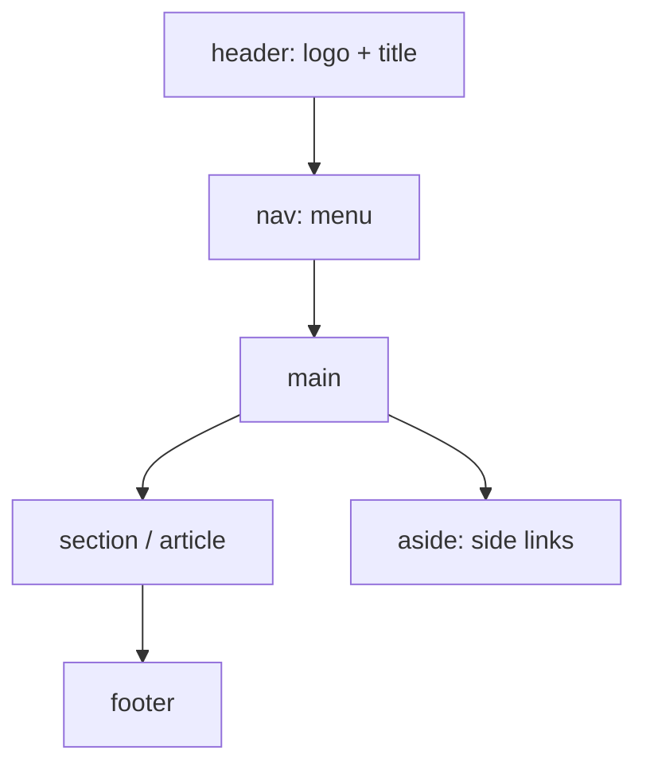

# Session 03: CSS3, Semantic Layout and Forms

> Module: Client-Side Scripting with HTML5 and JavaScript · Diploma in Cybersecurity and Digital Forensics · Term 1 · ⏱ ~2 hours

This session covers two big topics. First, **CSS3**: how to select elements and style them with classes, IDs and link states. Second, **HTML5 layout and forms**: semantic tags, a navigation bar, and modern form inputs. Forms are where users (and attackers) send data to a server, so we will also look at what browser validation can and cannot protect.

## 🎯 Learning Objectives

- Add CSS inline, internally and externally, and use new CSS3 features
- Use element, class, ID, descendant, group, attribute and pseudo-class selectors
- Style hyperlinks with `:link`, `:visited`, `:hover`, `:active`, `:focus`
- Build a page layout with `<header>`, `<nav>`, `<main>`, `<section>`, `<article>`, `<aside>`, `<footer>`
- Create HTML5 forms with new input types, attributes (`required`, `pattern`) and elements (`<datalist>`, `<output>`)
- Explain hidden fields and why client-side validation is not security

## 📖 Concepts Explained

### 1. Three ways to add CSS

| Method | Example | Best for |
|---|---|---|
| Inline | `<p style="color:red">` | quick tests only |
| Internal | `<style> p { color: red; } </style>` in `<head>` | one page |
| External | `<link rel="stylesheet" href="style.css">` | whole websites (recommended) |

A CSS rule is `selector { property: value; }`.

### 2. What CSS3 added

Rounded corners (`border-radius`), shadows (`box-shadow`, `text-shadow`), gradients, web fonts (`@font-face`), transitions and animations, media queries for responsive design, Flexbox and Grid layouts, and many new selectors.

### 3. Selectors

| Selector | Example | Selects |
|---|---|---|
| Element | `p` | all paragraphs |
| Class | `.alert` | elements with `class="alert"` (reusable) |
| ID | `#login` | the one element with `id="login"` (unique) |
| Descendant (nested) | `nav a` | links inside `<nav>` |
| Child | `ul > li` | direct children only |
| Group | `h1, h2` | both |
| Attribute | `input[type="email"]` | email inputs |
| Pseudo-class | `li:nth-child(odd)`, `a:hover` | by state or position |
| Universal | `*` | everything |

**Specificity:** inline style > ID > class/attribute/pseudo-class > element. When two rules clash, the more specific wins; if equal, the later one wins.

### 4. Styling links

Order matters, remember **LoVe HAte**: `:link`, `:visited`, `:hover`, `:active`. Add `:focus` so keyboard users can see where they are.

### 5. Semantic layout



`<div>` is a generic box with no meaning; use it only when no semantic tag fits. A **navigation bar** is usually `<nav>` holding a `<ul>` of links, styled horizontally with Flexbox.

### 6. HTML5 forms

```html
<form action="/register" method="post">
```

- `action` = where data goes; `method="get"` puts data in the URL (never for passwords), `method="post"` sends it in the request body.

**New input types:** `email`, `url`, `tel`, `number`, `range`, `date`, `time`, `color`, `search`, `password`.

**New attributes:** `required`, `placeholder`, `pattern`, `min`, `max`, `step`, `autofocus`, `autocomplete`, `minlength`, `maxlength`.

**New elements:** `<datalist>` (suggestions), `<output>` (show a result), `<progress>`, `<meter>`.

### 7. Hidden fields

`<input type="hidden" name="course" value="CS101">` sends a value the user does not see. It is **not secret**: anyone can read and change it with Developer Tools.

### 8. Client-side validation is not security

Browser checks (`required`, `pattern`, `type="email"`) help honest users. An attacker can turn them off, edit the HTML, or send a request directly with tools such as `curl`. **The server must always validate again.**

## 💻 Code Examples

### Example 1: External CSS with selectors (`layout.html` + `style.css`)

```css
/* style.css */
body { font-family: Arial, sans-serif; margin: 0; }
header, footer { background: #0b3d91; color: white; padding: 16px; }
nav ul { display: flex; gap: 16px; list-style: none; margin: 0; padding: 10px; background: #e8eef7; }
nav a:link, nav a:visited { color: #0b3d91; text-decoration: none; }
nav a:hover, nav a:focus { text-decoration: underline; }
.container { display: flex; gap: 20px; padding: 16px; }
main { flex: 3; }
aside { flex: 1; background: #f6f6f6; padding: 10px; border-radius: 8px; }
.alert { border-left: 4px solid #c0392b; padding: 8px; box-shadow: 0 2px 4px #ccc; }
#welcome { color: #0b3d91; }
```

**How it works:** element selectors set the base, the nav uses Flexbox to sit in a row, link states change on hover, a class styles any warning box and an ID styles one unique heading.

### Example 2: Registration form (`form.html`)

```html
<form action="#" method="post">
  <label>Full name <input type="text" name="name" required minlength="3"></label>
  <label>Email <input type="email" name="email" required></label>
  <label>Roll no <input type="text" name="roll" pattern="[A-Z]{2}[0-9]{4}" placeholder="CS1234"></label>
  <label>Date of birth <input type="date" name="dob"></label>
  <label>Skill level <input type="range" name="level" min="1" max="5"></label>
  <label>Course <input list="courses" name="course"></label>
  <datalist id="courses"><option value="Cybersecurity"><option value="Networking"></datalist>
  <input type="hidden" name="batch" value="2601">
  <button type="submit">Register</button>
</form>
```

**How it works:** the browser checks `required`, `minlength`, `pattern` and `email` before submitting. The hidden field travels with the form but can still be edited by the user.

## 🧪 Lab Practice

1. Link `style.css` to `layout.html` and change the header colour using a class instead of the element selector.
2. Add a fourth menu item and style the current page link with a class `.active`.
3. Open `form.html`, try to submit with an invalid email and a roll number like `cs12`. Read the browser messages.
4. Press F12, find the hidden `batch` field, change its value, and think: should a server trust it?
5. In DevTools, delete the `required` attribute and submit an empty name. What does this prove?

## 📝 Assignment

Build `incident-report.html` with a semantic layout (header, nav, main, aside, footer) and an external stylesheet. The main area contains an **Incident Report** form with: reporter email, incident date and time, severity (`<select>`), affected system (`<datalist>`), description (`<textarea>`, minimum 20 characters), and a submit button. Style it with at least five different selector types.

## ❓ Quick Quiz

1. Which wins: an ID selector or a class selector?
2. Write a selector for links inside `<nav>` only.
3. Which form method should never be used for passwords, and why?
4. Which element provides suggestions for a text input?
5. Can a hidden field keep data secret from the user?

<details>
<summary>Show answers</summary>

1. The ID selector (higher specificity)
2. `nav a`
3. GET, because the data appears in the URL, browser history and server logs.
4. `<datalist>`
5. No. Anyone can view and change it with Developer Tools.

</details>

## 💼 Interview Questions

**1. Class vs ID?**

> A class can be used on many elements and is for reusable styles; an ID must be unique on the page and is used for one element or as a link/JS target.

**2. Why use semantic tags instead of only `<div>`s?**

> They describe the role of each part, improving accessibility, SEO and code readability.

**3. Is HTML5 form validation enough to stop malicious input?**

> No. It runs in the user's browser and can be bypassed. Validation and sanitisation must also happen on the server.

## ✅ Summary

- Use external CSS; rules are `selector { property: value; }`; specificity decides conflicts.
- CSS3 brings rounded corners, shadows, Flexbox/Grid, transitions and media queries.
- Semantic tags (`header`, `nav`, `main`, `article`, `aside`, `footer`) structure layouts.
- HTML5 forms have new input types and attributes, but server-side validation is always required.

---

[⬅ Previous](../Session-02-Text-Formatting-Lists-and-Hyperlinks/README.md) · [🏠 Module Home](../README.md) · [Next ➡](../Session-04-Tables-Audio-and-Video/README.md)

Prepared by Zeeshan Abbas · Aptech Learning North Nazimabad
