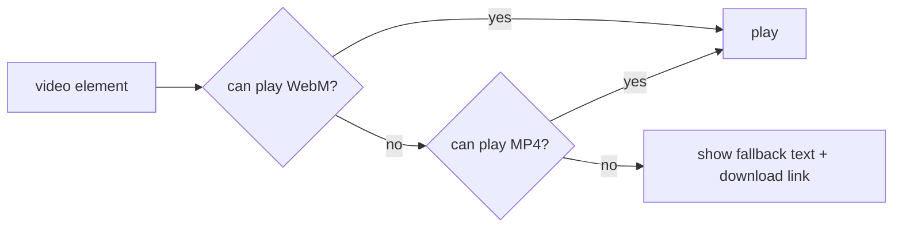

# Session 04: Tables, Audio and Video

> Module: Client-Side Scripting with HTML5 and JavaScript · Diploma in Cybersecurity and Digital Forensics · Term 1 · ⏱ ~2 hours

Tables organise data such as firewall rules, scan results or timetables. Multimedia brings pages to life with sound and video. In this session you will build and format tables, merge cells, and add accessible audio and video with HTML5, including fallbacks for older browsers.

## 🎯 Learning Objectives

- Create tables with `<table>`, `<tr>`, `<th>`, `<td>`, `<caption>`, `<thead>`, `<tbody>`, `<tfoot>`
- Control table size and column width with CSS
- Merge cells with `colspan` and `rowspan`
- Explain why tables should not be used for page layout
- Add audio and video with `<audio>`, `<video>` and `<source>`
- Make media accessible with captions (`<track>`) and handle non-supporting browsers

## 📖 Concepts Explained

### 1. Table building blocks

| Tag | Meaning |
|---|---|
| `<table>` | the whole table |
| `<caption>` | title of the table |
| `<thead>`, `<tbody>`, `<tfoot>` | header, body and footer groups |
| `<tr>` | table row |
| `<th>` | header cell (bold, centred, meaningful to screen readers) |
| `<td>` | data cell |

Use `scope="col"` or `scope="row"` on `<th>` to tell assistive tools what each header describes.

### 2. Formatting tables with CSS

| Need | CSS |
|---|---|
| single lines instead of double borders | `border-collapse: collapse;` |
| borders | `th, td { border: 1px solid #999; }` |
| space inside cells | `padding: 8px;` |
| table width | `width: 100%;` or `width: 600px;` |
| column width | `<col style="width:30%">` inside `<colgroup>`, or width on `th` |
| striped rows | `tbody tr:nth-child(even) { background: #f2f2f2; }` |

Old attributes such as `border="1"`, `cellpadding` and `bgcolor` are obsolete in HTML5; use CSS.

### 3. Merging cells

- `colspan="2"`: a cell stretches across two columns.
- `rowspan="3"`: a cell stretches down three rows.

When a cell spans, write fewer cells in the rows it covers.

### 4. Tables for layout?

In the 1990s whole pages were laid out with tables. Today use **semantic tags with Flexbox or Grid** for layout. Tables are only for **tabular data**. Layout tables confuse screen readers and break on mobiles.

### 5. Why multimedia in HTML5?

Before HTML5, audio and video needed plug-ins like Flash, which were slow, crashed, and had many security vulnerabilities. HTML5 made media native, so it works on phones and needs no plug-in.

### 6. Supported formats

| Media | Formats | Widely supported |
|---|---|---|
| Audio | MP3, OGG, WAV, AAC | MP3 |
| Video | MP4 (H.264), WebM, OGG | MP4 |

Give several `<source>` elements; the browser uses the first one it can play.

### 7. Audio and video attributes

| Attribute | Effect |
|---|---|
| `controls` | show play, pause, volume |
| `autoplay` | start automatically (browsers block it unless `muted`) |
| `muted` | start without sound |
| `loop` | repeat |
| `poster` (video) | image shown before play |
| `width` / `height` (video) | size |
| `preload` | `none`, `metadata` or `auto` |

### 8. Accessibility and fallbacks

- `<track kind="captions" src="intro.vtt" srclang="en" label="English">` adds captions in **WebVTT** format for deaf users and noisy places.
- Text inside `<video>...</video>` is shown only by browsers that cannot play it; include a download link there.



## 💻 Code Examples

### Example 1: Firewall rules table (`table.html`)

```html
<table>
  <caption>Firewall Rules - Lab Network</caption>
  <thead>
    <tr><th scope="col">#</th><th scope="col">Port</th><th scope="col">Service</th><th scope="col">Action</th></tr>
  </thead>
  <tbody>
    <tr><td>1</td><td>22</td><td>SSH</td><td class="allow">Allow (admin LAN only)</td></tr>
    <tr><td>2</td><td>80</td><td>HTTP</td><td class="deny">Deny</td></tr>
    <tr><td>3</td><td>443</td><td>HTTPS</td><td class="allow">Allow</td></tr>
  </tbody>
  <tfoot>
    <tr><td colspan="4">Default policy: deny everything else</td></tr>
  </tfoot>
</table>
```

**How it works:** header, body and footer are grouped; the footer cell spans all four columns with `colspan`.

### Example 2: Timetable with rowspan (`timetable.html`)

The file shows a weekly lab timetable where a 2-hour practical spans two rows with `rowspan="2"`, plus a `<colgroup>` to set column widths.

### Example 3: Video with captions and fallback (`media.html`)

```html
<video controls width="640" poster="poster.jpg" preload="metadata">
  <source src="intro.webm" type="video/webm">
  <source src="intro.mp4" type="video/mp4">
  <track kind="captions" src="intro.vtt" srclang="en" label="English" default>
  Your browser cannot play this video. <a href="intro.mp4">Download it</a>.
</video>

<audio controls>
  <source src="alert.mp3" type="audio/mpeg">
  Your browser does not support audio.
</audio>
```

**How it works:** the browser tries WebM then MP4, shows captions from the `.vtt` file, and displays the fallback text only if it cannot play either. A sample `intro.vtt` caption file is included; add your own short `intro.mp4` and `alert.mp3` to test.

## 🧪 Lab Practice

1. Open `table.html`, add two more rules, and make even rows striped with CSS.
2. Set the Service column to 40% width using `<colgroup>`.
3. In `timetable.html`, add a lunch break row that spans all columns.
4. Record a 10-second clip on your phone, save it as `intro.mp4` next to `media.html`, and play it with controls.
5. Edit `intro.vtt` so captions appear at 0-3 s and 3-6 s, then turn captions on in the player.

## 📝 Assignment

Create `scan-report.html`: a table showing results of a scan of **your own** lab VM (IP, port, state, service, risk). Use caption, `thead`/`tbody`/`tfoot`, at least one `colspan` and one `rowspan`, and CSS colours for risk levels. Below it, embed a short screen-recording video (your own) explaining the table, with a fallback message.

## ❓ Quick Quiz

1. Which tag creates a header cell?
2. Which CSS property removes double borders in tables?
3. What does `rowspan="2"` do?
4. Why provide more than one `<source>` in a `<video>`?
5. What file format does `<track>` use for captions?

<details>
<summary>Show answers</summary>

1. `<th>`
2. `border-collapse: collapse;`
3. The cell extends down across two rows.
4. Different browsers support different formats; the browser plays the first one it supports.
5. WebVTT (`.vtt`)

</details>

## 💼 Interview Questions

**1. Why should tables not be used for page layout?**

> They mix structure with presentation, are hard to make responsive, and confuse screen readers. Use CSS Flexbox/Grid for layout.

**2. Why did HTML5 media replace Flash?**

> Native media needs no plug-in, works on mobiles, uses less power and removes a plug-in that had many serious security flaws.

**3. How do you make video accessible?**

> Add captions/subtitles with `<track>`, provide transcripts, keep controls visible, and avoid autoplay with sound.

## ✅ Summary

- Tables are for data: use caption, `thead`, `tbody`, `tfoot`, `th` with `scope`.
- Style tables with CSS; merge with `colspan` and `rowspan`.
- `<audio>` and `<video>` play media natively with multiple `<source>` options.
- Add captions with `<track>` and fallback text for unsupported browsers.

---

[⬅ Previous](../Session-03-CSS3-Semantic-Layout-and-Forms/README.md) · [🏠 Module Home](../README.md) · [Next ➡](../Session-05-Practice-Lab-HTML5-and-CSS3/README.md)

Prepared by Zeeshan Abbas · Aptech Learning North Nazimabad
