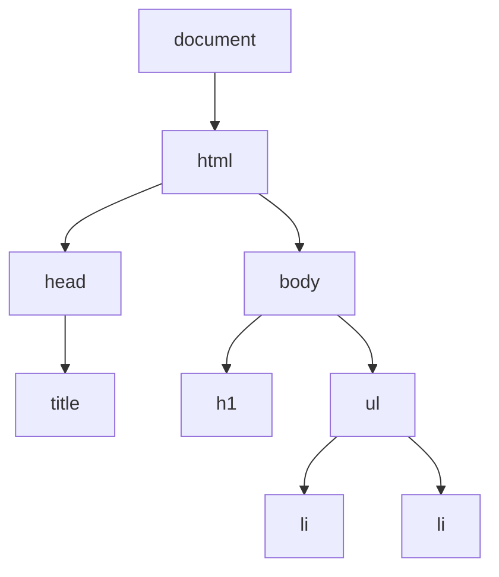

# Session 07: Functions, Objects, DOM and Modern JavaScript

> Module: Client-Side Scripting with HTML5 and JavaScript · Diploma in Cybersecurity and Digital Forensics · Term 1 · ⏱ ~2 hours

This session moves from basics to the tools real web applications use: functions, objects, browser objects and the DOM, JSON for data exchange, and modern language features from ECMAScript 2021-2022 such as `Promise.any`, private class methods, top-level `await` and static initialisation blocks.

## 🎯 Learning Objectives

- Write functions with parameters, default values and `return`, including arrow functions
- Create objects and classes, and use private fields and methods (`#`)
- Use browser objects (`window`, `document`, `location`, `navigator`, `history`) and the DOM
- Convert data with `JSON.stringify` and `JSON.parse`
- Use promises, `async/await`, `Promise.any` and top-level `await` in modules
- Explain other ES2022 features: static blocks, `.at()`, `Object.hasOwn`, error `cause`

## 📖 Concepts Explained

### 1. Functions

```js
function greet(name = "student") {   // parameter with default
  return `Hello, ${name}`;           // return sends a value back
}
const square = n => n * n;           // arrow function
```

A function without `return` gives `undefined`. Functions are values: you can pass them to other functions (callbacks), like `addEventListener("click", handler)`.

### 2. Objects

An **object** groups related data (properties) and behaviour (methods):

```js
const server = {
  ip: "10.0.0.5",
  ports: [22, 443],
  describe() { return `${this.ip} has ${this.ports.length} open ports`; }
};
```

Access with `server.ip` or `server["ip"]`. Built-in objects include `Math`, `Date`, `String`, `Array`, `JSON`.

### 3. Classes and private members

```js
class Account {
  #password;                       // private field: only usable inside the class
  constructor(user, password) { this.user = user; this.#password = password; }
  #hash(text) { return text.length; }   // private method (ES2022)
  check(attempt) { return this.#hash(attempt) === this.#hash(this.#password); }
}
```

Code outside the class cannot read `#password` or call `#hash()`; trying is a syntax error. This is **encapsulation**. (Private members protect code structure, not real secrets; anything in browser memory can still be inspected.)

### 4. Browser objects (BOM)

| Object | Example |
|---|---|
| `window` | `window.innerWidth`, `setTimeout()` |
| `document` | the page itself (DOM) |
| `location` | `location.href`, `location.hostname` |
| `navigator` | `navigator.userAgent`, `navigator.language` |
| `history` | `history.back()` |
| `screen` | `screen.width` |

### 5. The DOM

The **Document Object Model** is the browser's tree of objects for the page.



| Task | Method |
|---|---|
| Find | `document.querySelector("#id")`, `querySelectorAll(".cls")` |
| Change text | `el.textContent = "..."` |
| Change style/class | `el.style.color = "red"`, `el.classList.add("alert")` |
| Create and add | `document.createElement("li")`, `parent.append(child)` |
| Remove | `el.remove()` |

### 6. JSON

**JSON** (JavaScript Object Notation) is the text format APIs use to send data. Keys must be in double quotes.

```js
const text = JSON.stringify({ user: "ali", role: "admin" });  // object -> text
const obj  = JSON.parse('{"user":"ali","role":"admin"}');     // text -> object
```

Never use `eval()` to read JSON; `JSON.parse` is safe because it only builds data, never runs code.

### 7. Promises, async/await and `Promise.any`

A **promise** represents a result that will arrive later (network request, timer). `async/await` lets you write that code step by step.

| Combinator | Resolves when |
|---|---|
| `Promise.all` | all succeed (fails if one fails) |
| `Promise.allSettled` | all finish (success or failure) |
| `Promise.race` | the first one settles |
| `Promise.any` (ES2021) | the **first success**; fails with `AggregateError` only if all fail |

`Promise.any` is useful to try several mirror servers and use whichever answers first.

### 8. ECMAScript 2022 features

| Feature | Example |
|---|---|
| Top-level `await` | in `<script type="module">`: `const data = await fetch(url);` with no async function around it |
| Static initialisation block | `class Config { static { Config.mode = "lab"; } }` runs once when the class is defined |
| Private methods/fields | `#secret`, `#method()` |
| `.at()` | `ports.at(-1)` = last element |
| `Object.hasOwn(obj, "key")` | safer than `obj.hasOwnProperty` |
| Error cause | `new Error("Login failed", { cause: err })` |

## 💻 Code Examples

### Example 1: Functions and objects (`functions_objects.js`)

```js
function isWellKnown(port) {                 // parameter
  return port >= 0 && port <= 1023;          // return value
}
const toLabel = port => `${port}${isWellKnown(port) ? " (well-known)" : ""}`;

const host = {
  name: "lab-vm",
  ports: [22, 8080, 443],
  report() { return this.ports.map(toLabel).join(", "); }
};
console.log(host.name, "->", host.report());
console.log("Last port:", host.ports.at(-1));                 // ES2022
console.log("Has name?", Object.hasOwn(host, "name"));        // ES2022
```

**How it works:** a regular function, an arrow function and an object method work together; `.at(-1)` reads from the end.

### Example 2: DOM to-do list with JSON (`dom_todo.html`)

```js
const list = document.querySelector("#tasks");
const input = document.querySelector("#task");
const tasks = [];

document.querySelector("#add").addEventListener("click", () => {
  const text = input.value.trim();
  if (text === "") return;
  tasks.push({ text, done: false });
  const li = document.createElement("li");
  li.textContent = text;                       // safe: no HTML parsing
  list.append(li);
  input.value = "";
  document.querySelector("#json").textContent = JSON.stringify(tasks, null, 2);
});
```

**How it works:** each click creates an `<li>` node, adds it to the list and shows the data as formatted JSON.

### Example 3: Classes, private methods and static blocks (`es2022_class.js`)

See the file: an `Account` class with a private field, a private method and a static block that sets a lockout limit.

### Example 4: `Promise.any` and top-level await (`promise_any.html`)

```js
// inside <script type="module">
const wait = (ms, label, ok = true) =>
  new Promise((resolve, reject) => setTimeout(() => ok ? resolve(label) : reject(label), ms));

const fastest = await Promise.any([          // top-level await
  wait(900, "Mirror A"),
  wait(300, "Mirror B", false),              // fails
  wait(500, "Mirror C")
]);
document.querySelector("#out").textContent = `First working mirror: ${fastest}`;
```

**How it works:** Mirror B fails, so `Promise.any` ignores it and returns Mirror C, the first success. `await` works at the top level because the script is a module.

## 🧪 Lab Practice

1. Run `node functions_objects.js`. Add a method `addPort(p)` to `host` that pushes a port only if it is valid.
2. In `dom_todo.html`, add a "Clear" button that removes all items with `list.replaceChildren()`.
3. In the Console, type `location.hostname`, `navigator.language`, `screen.width` and note the results.
4. In `es2022_class.js`, try `console.log(acc.#password)` outside the class and read the error.
5. In `promise_any.html`, make all three mirrors fail and catch the `AggregateError` with `try...catch`.

## 📝 Assignment

Create `contacts.html`: a form (name, email) that adds contacts to an array of objects and displays them in a list via DOM methods. Add a "Export JSON" button that shows `JSON.stringify` output in a `<pre>`, and an "Import JSON" textarea that uses `JSON.parse` inside `try...catch` to load contacts back.

## ❓ Quick Quiz

1. What does a function return if it has no `return` statement?
2. How do you mark a class field as private?
3. Which method finds the first element matching a CSS selector?
4. What does `Promise.any` return if every promise fails?
5. Why use `JSON.parse` instead of `eval` for JSON?

<details>
<summary>Show answers</summary>

1. `undefined`
2. Prefix its name with `#`, e.g. `#password`
3. `document.querySelector()`
4. It rejects with an `AggregateError`.
5. `JSON.parse` only creates data; `eval` would run any code inside the text, which is a serious security risk.

</details>

## 💼 Interview Questions

**1. What is the DOM?**

> A tree of objects the browser builds from HTML so scripts can read and change the page's content, structure and style.

**2. Difference between `Promise.race` and `Promise.any`?**

> `race` settles with the first promise to finish, even if it failed; `any` waits for the first one that succeeds.

**3. What is top-level await?**

> In ES modules you can use `await` outside an async function, which simplifies loading data or config before the rest of the module runs.

## ✅ Summary

- Functions take parameters and return values; arrow functions are short forms.
- Objects and classes group data and behaviour; `#` makes members private.
- Browser objects and the DOM let scripts read and change the page.
- JSON is the data format of the web; parse it safely.
- Modern JS: promises, `Promise.any`, top-level await, static blocks, `.at()`.

---

[⬅ Previous](../Session-06-JavaScript-Basics/README.md) · [🏠 Module Home](../README.md) · [Next ➡](../Session-08-Canvas-and-Web-Storage/README.md)

Prepared by Zeeshan Abbas · Aptech Learning North Nazimabad
