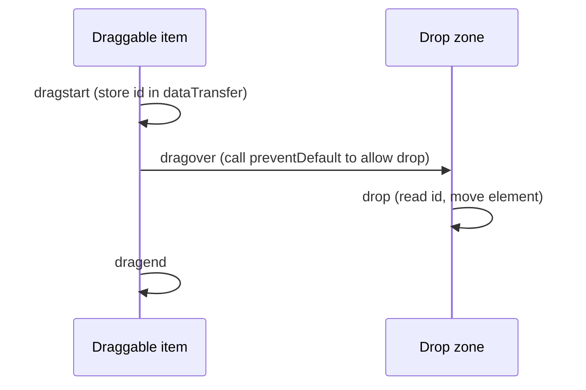

# Session 09: Geolocation, Drag and Drop and Web APIs

> Module: Client-Side Scripting with HTML5 and JavaScript · Diploma in Cybersecurity and Digital Forensics · Term 1 · ⏱ ~2 hours

Modern browsers expose powerful APIs: they can find the user's location, show maps, and let users drag and drop items and files. These features are useful, and they are also privacy-sensitive, which is why browsers ask for permission. This session covers Geolocation, maps, drag-and-drop, and the story of the Application Cache and its replacement, service workers.

## 🎯 Learning Objectives

- Explain how the Geolocation API works and why it needs permission and HTTPS
- Get the current position and handle errors and options
- Show a location on a map (Google Maps Embed / JavaScript API, or OpenStreetMap)
- Build drag-and-drop interactions with the HTML5 Drag and Drop API
- Read dropped files safely on the client side
- Describe Application Cache, why it was removed, and how service workers replace it

## 📖 Concepts Explained

### 1. Geolocation

`navigator.geolocation` gives latitude and longitude from GPS, Wi-Fi, mobile towers or IP address.

| Method | Purpose |
|---|---|
| `getCurrentPosition(success, error, options)` | one reading |
| `watchPosition(...)` | keep updating as the device moves |
| `clearWatch(id)` | stop watching |

The success callback receives `position.coords`: `latitude`, `longitude`, `accuracy` (metres), and sometimes `altitude`, `speed`.

**Error codes:** 1 = permission denied, 2 = position unavailable, 3 = timeout.

**Options:** `{ enableHighAccuracy: true, timeout: 10000, maximumAge: 0 }`.

### 2. Privacy and security

- The browser always asks the user first; the user can block it.
- Geolocation works only on **secure origins** (HTTPS or `localhost`).
- Location is **personal data** under privacy laws such as GDPR. Ask only when needed, explain why, and do not store it longer than necessary.
- Photos can also leak location through EXIF metadata; investigators use this, and so do stalkers.

### 3. Maps

| Option | Notes |
|---|---|
| Google Maps Embed API | an `<iframe>` with a URL; needs an API key from Google Cloud |
| Google Maps JavaScript API | full interactive maps, markers, routes; needs an API key and billing account |
| OpenStreetMap | free map data; simple embed iframe or libraries such as Leaflet |

**API keys:** restrict them in the provider console (by website/referrer and by API) because any key in client code is visible to everyone.

### 4. Drag and drop



| Step | Code |
|---|---|
| Make draggable | `<div draggable="true">` (images and links are draggable by default) |
| Start | `dragstart` → `event.dataTransfer.setData("text/plain", id)` |
| Allow drop | `dragover` → `event.preventDefault()` |
| Drop | `drop` → `event.dataTransfer.getData("text/plain")` |

Files dragged from the desktop arrive in `event.dataTransfer.files`. Read them with `FileReader` or `file.text()`. Reading happens locally; nothing is uploaded unless your code sends it.

### 5. Application Cache (history) and service workers

The old **Application Cache** used a `manifest` attribute on `<html>` and a `.appcache` file listing files to keep offline. It was hard to control, caused stale pages, and had security problems, so it was **deprecated and removed** from all major browsers (Chrome removed it in 2021).

The replacement is the **service worker**: a JavaScript file that sits between the page and the network, can cache files with the **Cache API**, and makes pages work offline. Service workers require HTTPS because they are so powerful.

| | Application Cache (removed) | Service worker (current) |
|---|---|---|
| Control | declarative list, little control | full code control |
| Updates | confusing | versioned caches you manage |
| Status | removed | supported in all modern browsers |

## 💻 Code Examples

### Example 1: Where am I? (`geolocation.html`)

```js
const out = document.querySelector("#out");

document.querySelector("#locate").addEventListener("click", () => {
  if (!("geolocation" in navigator)) {
    out.textContent = "Geolocation not supported";
    return;
  }
  navigator.geolocation.getCurrentPosition(
    (pos) => {
      const { latitude, longitude, accuracy } = pos.coords;
      out.textContent = `Lat ${latitude.toFixed(4)}, Lon ${longitude.toFixed(4)} (±${Math.round(accuracy)} m)`;
      document.querySelector("#map").src =
        `https://www.openstreetmap.org/export/embed.html?bbox=${longitude - 0.01},${latitude - 0.01},${longitude + 0.01},${latitude + 0.01}&marker=${latitude},${longitude}`;
    },
    (err) => { out.textContent = `Error ${err.code}: ${err.message}`; },
    { enableHighAccuracy: true, timeout: 10000 }
  );
});
```

**How it works:** after the user clicks and allows access, the coordinates are shown and an OpenStreetMap iframe centres on them. If the user blocks it, the error callback runs. Run it from `localhost` (Live Server) or HTTPS.

### Example 2: Google Maps embed (`google_map_embed.html`)

Shows the Google Maps Embed API iframe format with a `YOUR_API_KEY` placeholder and a note on restricting the key.

### Example 3: Drag tasks between columns (`drag_drop.html`)

```js
document.querySelectorAll(".task").forEach(task => {
  task.addEventListener("dragstart", e => e.dataTransfer.setData("text/plain", task.id));
});

document.querySelectorAll(".column").forEach(col => {
  col.addEventListener("dragover", e => e.preventDefault());    // allow drop
  col.addEventListener("drop", e => {
    e.preventDefault();
    const id = e.dataTransfer.getData("text/plain");
    col.append(document.getElementById(id));                     // move the card
  });
});
```

**How it works:** each card stores its `id` when dragging starts; a column accepts the drop and moves the card into itself.

### Example 4: Drop a text file to count lines (`file_drop.html`)

Drop any `.txt` or `.log` file on the box; the page reads it locally with `file.text()` and shows its name, size and number of lines. Nothing is uploaded.

## 🧪 Lab Practice

1. Run `geolocation.html` via Live Server. Allow, then block the permission (padlock icon → Site settings) and read the error code.
2. In DevTools → More tools → **Sensors**, override the location to Karachi (24.8607, 67.0011) and test again.
3. Add a "Done" column to `drag_drop.html` and highlight a column while an item is dragged over it (`dragenter`/`dragleave`).
4. In `file_drop.html`, also count lines that contain the word `ERROR`.
5. Look up the Application tab in DevTools → Service Workers and Cache Storage on a site you use, and note what is cached.

## 📝 Assignment

Build `incident-board.html`: a drag-and-drop board with three columns (New, Investigating, Resolved). Cards are created from a form, moved by dragging, and the board state is saved in `localStorage`. Add a drop zone that accepts a `.log` file and creates one card per line containing `FAILED`.

## ❓ Quick Quiz

1. Which object provides location in the browser?
2. What does error code 1 mean in Geolocation?
3. Which event must call `preventDefault()` to allow a drop?
4. Why was Application Cache removed?
5. Why must Google Maps API keys be restricted?

<details>
<summary>Show answers</summary>

1. `navigator.geolocation`
2. Permission denied
3. `dragover`
4. It was hard to control, caused stale content and security issues; service workers replaced it.
5. Keys in client code are visible to anyone; restrictions stop others from using your key and running up charges.

</details>

## 💼 Interview Questions

**1. Why does Geolocation require HTTPS?**

> Location is sensitive; HTTPS prevents attackers on the network from injecting scripts that silently request or steal it.

**2. What is a service worker?**

> A background script that intercepts network requests for its site, enabling offline caching, push notifications and background sync.

**3. Is reading a dropped file with `FileReader` an upload?**

> No. The file is read in the browser's memory; it only leaves the device if your code sends it with `fetch` or a form.

## ✅ Summary

- Geolocation gives coordinates with permission, on HTTPS, and must be treated as personal data.
- Maps can be embedded from Google (API key) or OpenStreetMap.
- Drag and drop uses `dragstart`, `dragover` (preventDefault) and `drop`; files can be read locally.
- Application Cache is gone; service workers and the Cache API provide offline support today.

---

[⬅ Previous](../Session-08-Canvas-and-Web-Storage/README.md) · [🏠 Module Home](../README.md) · [Next ➡](../Session-10-Practice-Lab-JavaScript-and-Web-APIs/README.md)

Prepared by Zeeshan Abbas · Aptech Learning North Nazimabad
