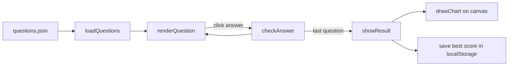

# Session 10: Practice Lab: JavaScript and Web APIs

> Module: Client-Side Scripting with HTML5 and JavaScript · Diploma in Cybersecurity and Digital Forensics · Term 1 · ⏱ ~2 hours

The closing practice lab for the module. You will combine JavaScript fundamentals, the DOM, JSON, Web Storage, canvas and web APIs into one small application: a **Security Awareness Quiz** that runs fully in the browser. You will also practise the secure front-end habits seen throughout the module.

## 🎯 Learning Objectives

- Structure a small JavaScript application into functions and data
- Load questions from JSON and render them with DOM methods
- Handle user events and keep state in variables and `localStorage`
- Draw a result chart on a canvas
- Apply secure front-end habits: `textContent`, no secrets in client code, input checks
- Debug with the DevTools Console, Sources and Application panels

## 📖 Concepts Explained

### 1. App structure



Keep **data** (questions), **state** (current index, score) and **view** (DOM updates) separate. This makes code easier to read and test.

### 2. Secure front-end checklist

| Habit | Why |
|---|---|
| Use `textContent`, not `innerHTML`, for any data | prevents XSS |
| Never put passwords, API secrets or answers you must protect in client code | users can read all JS |
| Validate input in JS **and** on the server | client checks can be bypassed |
| Use `===` and `const` | fewer logic bugs |
| Load libraries only from official sources; keep them updated | old jQuery versions have known XSS bugs |
| Add `rel="noopener noreferrer"` to new-tab links | stops tab-nabbing |

> In this quiz the answers are in the JSON file, so a curious user can cheat by reading it. That is fine for practice, but a real exam must check answers on a server. Good example of "client-side is not security".

### 3. Debugging with DevTools

| Panel | Use |
|---|---|
| Console | errors, `console.log`, try code |
| Sources | set breakpoints, step through code line by line |
| Network | see if `questions.json` loaded (status 200) |
| Application | inspect `localStorage`, `sessionStorage`, IndexedDB |
| Elements | see DOM changes live |

Add `debugger;` in your code to pause there when DevTools is open.

## 💻 Code Examples

### The quiz app (`quiz/`)

Files: `quiz/index.html`, `quiz/app.js`, `quiz/questions.json`, `quiz/style.css`. Run with VS Code Live Server.

```js
// app.js (key parts)
let questions = [];
let current = 0;
let score = 0;

async function loadQuestions() {
  const response = await fetch("questions.json");
  questions = await response.json();
  renderQuestion();
}

function renderQuestion() {
  const q = questions[current];
  document.querySelector("#question").textContent = `${current + 1}. ${q.text}`;
  const box = document.querySelector("#options");
  box.replaceChildren();                       // remove old buttons
  q.options.forEach((option, index) => {
    const btn = document.createElement("button");
    btn.textContent = option;                  // safe text
    btn.addEventListener("click", () => checkAnswer(index));
    box.append(btn);
  });
}

function checkAnswer(index) {
  if (index === questions[current].answer) score++;
  current++;
  if (current < questions.length) renderQuestion();
  else showResult();
}
```

**How it works:** questions load from JSON with `fetch`; each question creates fresh buttons; clicking checks the answer and moves on. `showResult()` (in the file) saves the best score in `localStorage` and calls `drawChart()` to draw correct vs wrong bars on a canvas.

## 🧪 Lab Practice

1. Run the quiz. Open the Network tab and confirm `questions.json` returned status 200.
2. Add five new questions to `questions.json` about topics from this module.
3. Shuffle the questions at the start (write a `shuffle(array)` function).
4. Add a 20-second timer per question with `setInterval`; when time runs out, count it as wrong.
5. Put a breakpoint inside `checkAnswer` in the Sources panel and step through one answer.

## 📝 Assignment

**Module mini-project:** extend the quiz into a "Cyber Awareness Portal": a home page (semantic layout + CSS), the quiz, a results history page that reads all past scores from `localStorage` and shows them in a table, and a canvas bar chart of the last five attempts. Submit the folder and a short README explaining one security limitation of a client-only quiz.

## ❓ Quick Quiz

1. Why does the quiz use `textContent` to show questions?
2. Can a user see the answers in `questions.json`? What would fix this in a real exam?
3. Which DevTools panel shows `localStorage`?
4. What does `replaceChildren()` with no arguments do?
5. Which keyword pauses code when DevTools is open?

<details>
<summary>Show answers</summary>

1. So that any HTML in the data is shown as text, preventing XSS.
2. Yes. Check answers on a server and send only the questions to the browser.
3. Application
4. Removes all child nodes of the element.
5. `debugger;`

</details>

## 💼 Interview Questions

**1. How do you prevent XSS in front-end code?**

> Treat all data as text (`textContent`, framework escaping), avoid `innerHTML`/`eval` with untrusted data, use a Content Security Policy, and validate/encode on the server.

**2. Why separate data, state and view?**

> Each part can be changed or tested on its own, and bugs are easier to locate.

**3. How do you find out why a `fetch` call failed?**

> Check the Console for errors (CORS, syntax), the Network tab for the status code and response, and wrap the call in `try...catch` to handle failures.

## ✅ Summary

- A small app = data (JSON) + state (variables) + view (DOM) + events.
- `fetch`, DOM methods, `localStorage` and canvas combine into a working tool.
- Secure habits: `textContent`, no secrets on the client, validate on the server too.
- DevTools (Console, Sources, Network, Application) is your main debugging kit.

---

[⬅ Previous](../Session-09-Geolocation-Drag-and-Drop-and-Web-APIs/README.md) · [🏠 Module Home](../README.md)

Prepared by Zeeshan Abbas · Aptech Learning North Nazimabad
